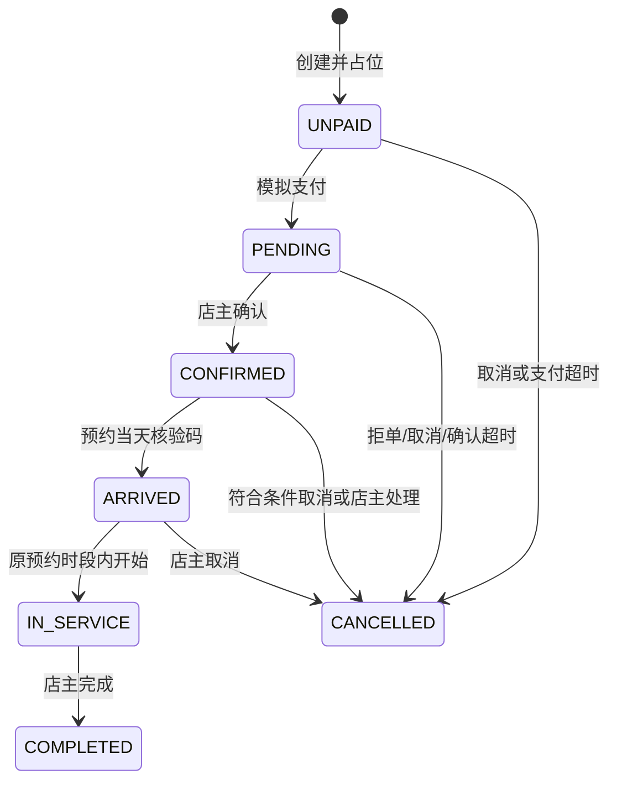
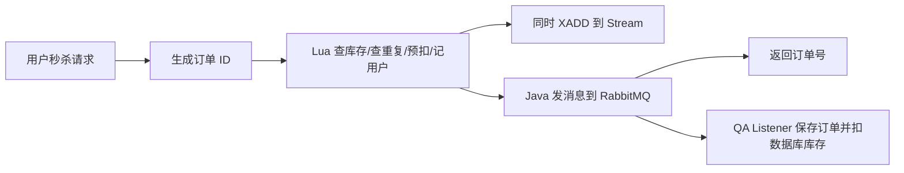

# Java 实习面试准备：项目业务与原理

> **历史版本提示：** 本文记录 2026-10-11 第一阶段状态，保留作学习对照。其中“宠物模块未接入 Redis/RabbitMQ”等描述不适用于第二阶段。当前面试准备请使用 [第二阶段问答手册](宠伴生活-Java后端实习面试问答手册.md) 与 [官方资料核对](Java面试官方资料核对-第二阶段.md)。

依据：2026-10-11 当前工作区源码。本文先解释业务，再连接技术原理。标为“改进”的内容不能当作已经实现；参考回答只有在你理解并实际参与相应工作时，才能使用第一人称。

## 1. 首先认清项目范围

仓库保留了两套业务代码，不能把它们合并描述为一个已经全部打通的平台。

| 项目部分 | 当前事实 | 适合讲什么 |
| --- | --- | --- |
| 宠伴洗护 `com.petcare` | 默认 Maven/JAR 入口；单店宠物服务预约，JdbcTemplate，默认文件型 H2，可配置 MySQL；入口排除 Redis、RabbitMQ、MyBatis-Plus 自动配置 | 业务建模、资源预约、订单状态、事务、幂等、权限、测试 |
| 原点评 `com.hmdp` | 保留独立入口；Spring Boot、MyBatis-Plus、MySQL、Redis、Redisson、RabbitMQ | 会话共享、缓存、Lua 秒杀、异步消费、关注、点赞、Feed、GEO、签到 |

这是同一 Maven 工程中的单体项目与两个入口，不是微服务架构。宠物模块暂未接入真实短信或支付，促销、社区和 AI 是后续规划。原点评中的 Stream 消费代码已注释，当前秒杀消息消费者是 RabbitMQ Listener。

面试可用的定位：**基于点评练习工程改造的单店宠物洗护预约系统，主要解决人员与时段资源冲突、重复下单、超时占位和履约状态约束；另保留点评模块用于学习 Redis 与消息队列。**

技术版本以 `dianping-master/pom.xml` 为准：Spring Boot 2.3.12，编译目标 Java 8；README 记录的 JDK 21/25 是测试或运行环境，不代表使用了 Java 21 的语言特性。

## 2. 先学会用业务语言介绍

不要从“我用了 Spring Boot、Redis、MQ”开始。先回答三件事：谁在用、要完成什么、哪里容易出错。

顾客希望知道某种服务什么时候能约，提交后保留名额，付款后到店接受服务。店主要管理规格、人员、排班，确认订单并记录履约。系统必须保证两个人不能同时占用同一位美容师的同一个时段，不能因为重复点击重复建单，也不能让未支付订单无限占位。

完整链路：


**可用时间查询只展示，不替用户保留。真正提交时再检查并占位。** 这是许多预约系统的关键区别：页面上的“还有一个名额”是查询时的结果，不是预订成功的承诺。

## 3. 业务对象与表设计

| 表 | 业务含义 | 为什么需要 |
| --- | --- | --- |
| `pet_store` | 门店及营业时间 | 约束服务不能超出营业时间 |
| `pet_spec` | 服务规格、种类、体重区间、价格、时长、类别 | 决定服务成本与需要的人员能力 |
| `pet_staff` | 美容师、启用状态与能力 | 并非所有员工都能接所有服务 |
| `pet_shift` | 某员工某日的一段连续排班 | 员工有能力不等于当天在岗 |
| `pet_order` | 订单、状态、时间、金额和业务快照 | 跟踪从预约到履约的完整过程 |
| `pet_slot` | 某员工某整点已被哪个订单占用 | 将资源冲突变成数据库可约束的数据 |
| `pet_lock` | 全店资源操作的锁行 | 串行化有冲突风险的操作 |
| `pet_review` | 完成订单的评价 | 确保评价来自真实完成订单，每单一次 |
| `pet_session` | 顾客或店主会话 | 服务端验证身份和角色 |
| `pet_login_code` | 验证码摘要、期限、尝试次数 | 管理验证码生命周期 |

当前没有独立宠物档案，一笔订单对应一只宠物和一个服务规格。不要声称实现了多宠物档案、购物车或组合套餐。

关键约束在 `src/main/resources/db/pet-schema.sql`：

- `pet_shift UNIQUE(staff_id, work_date)`：每人每日维护一段排班。
- `pet_slot PRIMARY KEY(staff_id, slot_start)`：同一人员同一整点最多一条占用。
- `pet_order UNIQUE(user_phone, request_key)`：同一顾客同一请求标识最多一单。
- `pet_review PRIMARY KEY(order_id)`：每单最多一条评价。
- 预约码唯一，订单和占位使用外键关联。

业务校验负责给出易理解的错误，数据库约束负责兜底；两者解决的问题不同。

## 4. 重点一：如何判断能否预约

代码：`PetBookingService.validateTime()`、`availableStaff()`、`availability()`、`create()`。

假设顾客选择“大型犬洗澡”，需两小时，想约明天 14:00。系统不能只数“14 点空闲的人”，需要对同一位美容师检查：

1. 员工启用且有该服务类别的能力。
2. 排班覆盖 14:00–16:00 全部时长。
3. 14:00 和 15:00 两个整点均未占用。
4. 服务在营业时间内、开始为整点。
5. 包含今天的七天内，至少提前两小时。
6. 宠物种类、体重符合规格；代码的体重范围是 `(minWeight, maxWeight]`。

一个员工 14–15 点有空、另一个员工 15–16 点有空，不能拼成一次两小时预约，因为服务由同一员工承接。

查询返回每个开始时间的可用人员数；提交时选择符合条件且 ID 最小的人员，不是智能调度或最优负载均衡。

时间区间使用 `[开始, 结束)`。两小时订单占住 14:00、15:00，不占 16:00，因此下一单可从 16:00 开始。对应占用检查 `slot_start >= start AND slot_start < end`。

**面试讲法：**“服务库存不是一个数字，而是有能力人员在完整服务时长内的连续空闲时间。我把整小时资源映射为占位记录，对同一位员工校验能力、排班和所有小时，解决了多小时服务部分重叠的问题。”

追问：如果改成 30 分钟预约？粒度改成半小时并确保时长可映射为完整粒度；粒度越细，占位条数越多。如果支持任意起止时间，可用重叠条件 `existing.start < new.end AND existing.end > new.start`，但光做查询仍不能保证并发安全，需要共同资源锁或其他原子约束。均属于改进方案。

## 5. 重点二：两个人同时抢最后一个时段

代码：`PetData.lock()`、`PetBookingService.create()`、`occupy()`。

问题：两个请求同时读到“空闲”，如果分别写入，就可能重复预约。前端禁用按钮只能限制当前页面，挡不住另一台设备或并发请求。

当前方案：**数据库行锁 + 事务 + 占位联合主键**。

```sql
SELECT id FROM pet_lock WHERE id=1 FOR UPDATE;
```

请求 A 在事务内获得锁行，清理到期订单，重新检查幂等标识、规格与资源，写订单、写所有小时占位。事务结束释放锁后，请求 B 才进入，它重新检查时就发现没有名额，返回 409。

不是锁住了所有 `pet_slot` 行，而是让参与资源协调的操作竞争同一行 `pet_lock`。取消、换人、排班编辑等操作也遵守这套协议。锁必须处于事务中，单独执行后立刻提交就无法保护后续业务步骤。

联合主键是第二层保护；如果某段代码绕过业务锁，仍不能插入同一员工同一整点的第二条占位。订单写入与多小时占位在同一事务内，常规数据库异常会回滚，避免写入一半。

**面试讲法：**“单店规模下，我选择数据库统一锁行来协调下单、取消和换人，在锁内重新校验，再用同一事务提交订单与占位；联合主键兜底防止重复资源占用。”

为什么不用 synchronized？它只能协调单 JVM，多个实例连接同一共享数据库时数据库行锁才能提供共同协调点。默认文件型 H2 的多进程部署能力另有限制，不能拿默认演示配置直接证明多实例部署；多实例应使用可共享访问的数据库并验证。

为什么不用 Redis 分布式锁？当前只服务单店，数据库已经是持久化与约束中心；直接使用数据库锁减少跨系统协调成本。不是说数据库锁普遍优于 Redis，而是当前规模下选择更简单。

代价：全店资源操作串行化，甚至时间查询、订单列表也因先清理超时而拿锁，会限制吞吐。**改进：**按门店拆锁；进一步按员工和日期协调时，必须处理多个候选人员及换人的多锁顺序、死锁与重试，不能随意删掉全局锁。

## 6. 重点三：订单状态与业务权限

代码：`PetBookingService.pay()`、`action()`、`requireState()`、`cancel()`、`review()`。



中文含义：UNPAID 待支付，PENDING 已支付待确认，CONFIRMED 已确认，ARRIVED 已到店，IN_SERVICE 服务中，COMPLETED 已完成，CANCELLED 已取消。

状态控制解决的是“这个动作现在有没有业务意义”：未付款不能确认；未到店不能开始；没完成不能评价；服务开始后不能走当前取消流程。

除状态外还要校验角色、归属、时间和凭证：

- 顾客必须是订单本人。
- 店主身份在服务端校验，不能只隐藏工作台按钮。
- 到店码正确且为预约当天，才能到店核验。
- 开始服务必须在原预约时间内，并且该美容师没有另一笔服务中的订单。
- 迟到不自动延长结束时间，避免影响下一位顾客。
- 顾客已支付订单自行取消须距开始至少两小时；临近需店主处理。
- 完成后本人可以评价一次，评分 1–5。

当前是 `switch + 状态校验`，不是引入了状态机框架。重复确认、重复开始、重复完成等若已处于对应目标状态会返回原订单；不能承诺所有历史动作在任意后续状态都接受重试。

**面试讲法：**“我把订单状态作为可执行操作的前提，并同时校验操作者、订单归属和时间，避免跳过支付、核验或服务过程直接完成订单。”

## 7. 重点四：超时占位怎么释放

代码：`PetExpiry.releaseExpired()`、`expireLocked()`、`cancelLocked()`、`pay()`。

场景一：提交后一直不支付，占着员工时段。场景二：顾客付款后店主一直不接单，占位且顾客无法安排时间。

规则：待支付十分钟，已支付待确认三十分钟。代码写 `deadline`，到期条件是 `deadline <= now`。取消统一更新状态、取消原因、取消时间、退款标记，并删除占位。

当前不是 RabbitMQ 延迟关单，使用两层处理：

1. 定时任务首次延迟三十秒启动，之后每次执行结束十五秒后再运行。
2. 下单、支付、订单列表、时间查询、店主操作等会在锁内先清理超时订单。

因此任务暂未运行时，过期订单也不能继续支付。前端倒计时用于提示，真正是否过期由服务端时钟判断。单独订单详情 `order()` 不清理，不能说所有查询都会即时改变过期状态。

支付与过期处理为什么不会同时成功？二者都先拿同一锁，在锁内清理、读状态、转状态，因此只会按一个先后次序执行；不能仅依赖调度器“恰好准时”。

特殊事务细节：`PetBookingService` 类上有 `@Transactional(noRollbackFor = PetException.class)`。例如支付时先清理一笔过期订单，再因订单已取消抛业务异常，仍要保留之前的取消和资源释放。若默认回滚，支付虽然失败，刚完成的超时清理却撤销了。其他数据库异常仍按常规回滚。

**注意边界：**这是较宽的例外规则，必须确保业务异常发生前已完成的写入确实允许提交，不能把所有业务失败都解释成“事务必须提交”。可改进为把到期清理与订单动作划分更清楚的事务边界，设计锁顺序与重读规则，并测试失败时的部分写入。

退款当前只是 `refunded=paid` 的模拟结果；没有第三方退款请求、回调和资金对账。真实退款要设计独立退款状态、幂等退款单和失败补偿，不能把本地改标志等同于资金到账。

## 8. 重点五：重复下单、重复支付和幂等

代码：`create()`、`pay()`；数据库唯一约束 `(user_phone, request_key)`。

重复点击、网络超时重试、页面恢复均可能让同一请求到达多次。每次都创建新单会重复占位；每次支付都刷新截止时间会让顾客通过重试无限延长确认时间。

创建订单时传 `requestKey`：

- 同一用户、同一标识、相同规格/时段/宠物/联系人等内容：返回已有订单。
- 同一标识但内容改变：返回 409，要求重新预约。
- 真正新的业务请求使用新标识。

不能只查“用户是否有订单”，因为用户允许多次预约。幂等限制的是一个业务请求执行一次，不是用户一生只能下一个订单。即使原订单已取消，同标识同内容也返回原订单，不会自动重建。

支付时如果已支付且未取消，返回当前订单，不再次设置付款时间或确认截止时间。创建和支付均在锁内判断，避免两个重试都通过检查。

**面试讲法：**“我用请求标识区分一次业务请求与另一次预约，配合唯一约束和内容校验处理创建重试；支付则依据已支付状态返回原结果，避免重复执行和重复延长等待期限。”

幂等不是不允许重试，而是重复请求不会产生额外业务副作用。真实支付还需第三方交易号唯一、验签和回调幂等，当前未实现。

## 9. 重点六：金额可信与历史快照

代码：`create()`、`saveSpec()`、`reassign()`；订单结构见 `pet-schema.sql`。

报价必须来自服务端规格，不相信客户端的 `priceCents`。订单金额使用整数分，体重使用 BigDecimal。69 元保存为 6900 分，避免使用 double 表示金额的精度误差。

订单保存服务名称、规格、金额、时长、宠物、联系人以及人员姓名等快照。店主后来改价格或服务时长，不影响已下单的成交约定；历史订单不能每次都从最新规格拼装。

这是有意的数据冗余：主数据反映“现在卖什么”，订单快照反映“当时买了什么”。服务类别未完整快照，换人和能力检查仍关联规格类别，所以代码禁止有订单的规格改变服务类别；不要泛化为所有字段都完全独立于主表。

**面试讲法：**“客户端只提交规格和预约信息，金额由后端计算并固化到订单；同时保存服务名称、价格与时长快照，保证修改商品配置后历史订单仍保持原约定。”

追问浮点：BigDecimal 优先从字符串构造，避免 `new BigDecimal(0.1)` 带入二进制浮点误差。当前不是全项目金额均使用 BigDecimal，宠物金额用整数分，体重用 BigDecimal。

## 10. 重点七：店主改排班、换人时如何保证履约

代码：`saveStaff()`、`saveShift()`、`saveStore()`、`action(..., "reassign", ...)`。

人员停用、删除技能、缩短排班、改变营业时间都可能使已存在的有效订单无法履约。代码先查非取消/非完成订单，发现冲突就拒绝修改，要求先换人或取消。

换人校验新员工的能力、排班与完整时段空闲，随后在同一事务内删原占位、写新占位、更新员工与姓名。新占位失败时常规数据库异常回滚，不能把订单留成“已删原占位却没分配新人”。

当前自动分配总选第一位符合条件的人员，未实现负载均衡；服务拖延时用“已有服务中订单”阻止开始下一单，但没有自动重排后续订单。完成动作也没有删除占位，代码只在取消时删除，不能声称提前完成会立刻释放原预订时段。

**面试讲法：**“管理端配置更新也遵守已有订单约束，换人不是只改一个员工 ID，而是同时转移完整时段资源，确保订单与资源记录一致。”

## 11. 登录、安全与权限：两套实现分别讲

### 11.1 宠物预约模块

`PetAuth`：顾客验证码模拟登录；数据库会话保存 subject、role、期限，固定十二小时，不是 Redis 滑动续期。顾客与店主使用各自 token。`require()` 判断令牌、期限与角色，订单服务再判断本人归属。

验证码使用 SecureRandom 生成、摘要存储，五分钟过期、一分钟内不能重发、成功删除；错误次数持久化，达到五次后失效。`customerLogin()` 对业务异常不回滚，保证输错次数不会因抛异常被撤销。

店主密码来自配置，在进程内用随机盐和 PBKDF2WithHmacSHA256 派生后比较；不是实现了完整用户密码数据库。按 IP 记录五分钟内的尝试，限制为十次；记录在本机 ConcurrentHashMap，未实现多实例共享限流。验证码当前是演示返回，不是真短信。

401 表示未登录或会话失效，403 表示身份存在但权限不足，409 表示时段冲突或请求标识冲突。随机订单 ID 不等于权限控制，即使 ID 难猜也要验证归属。

### 11.2 原点评模块

代码：`UserServiceImpl.login()`、`RefreshTokenInterceptor`、`LoginInterceptor`、`MvcConfig`、`UserHolder`。

场景：多实例部署时，用户登录到 A，后续请求落到 B，本地 HttpSession 不能自然共享。这里使用随机 token 作为会话标识，在 Redis Hash 存用户 DTO，三十分钟 TTL；刷新拦截器解析 token，写入 ThreadLocal，并续期；登录拦截器对受保护接口检查当前用户。

刷新拦截器覆盖所有请求并在权限拦截器之前执行，因此已登录用户浏览公开商铺也能续期。不是 JWT，不是 Spring Security 的完整认证框架。

ThreadLocal 的作用是让同一请求线程下游获得当前用户，减少参数传递；跨线程不会自动传递，异步订单要显式传 userId。

**当前缺陷：**刷新拦截器 `afterCompletion()` 没有执行 `UserHolder.removeUser()`，登录拦截器也没有清理。Servlet 线程池复用可能使下次无 token 请求读到前次用户，存在身份串用风险。修复应在覆盖全请求的拦截器收尾移除 ThreadLocal，并考虑入口防御清理与异常路径。这是待修复，不是本文已完成的修改。

原点评验证码成功后未删除，未看到宠物模块那样的重试限制；不要把两套验证码策略混讲。

## 12. 原点评重点：商铺缓存

代码：`ShopServiceImpl.queryById()`、`update()`，`CacheClient`。

业务背景：商铺详情读多写少，热点店铺被反复访问。Redis 缓存减少数据库查询，但要区分不同问题。

| 问题 | 具体场景 | 方案及当前实现 |
| --- | --- | --- |
| 穿透 | 查询数据库本来不存在的商铺，每次都回源 | `queryWithPassThrough()` 有短期空值缓存实现，但不是当前详情调用路径 |
| 击穿 | 一个极热商铺失效，许多请求同时回源 | 当前详情调用逻辑过期，旧值先返回、抢锁者异步重建 |
| 雪崩 | 大批缓存同时过期或 Redis 整体不可用 | 可讨论随机 TTL、降级、限流；当前没有完整实现 |

逻辑过期：缓存 JSON 中存数据和业务到期时间；写入时不设 Redis TTL。未到期直接返回；到期则尝试互斥锁，成功者在线程池重建，其他请求返回旧值。牺牲短期新鲜度换取热点读取的低等待。

适合商铺介绍、地址等可接受短期旧值的数据；不适合用旧库存或旧支付状态判断交易成功。

**必须知道当前两个问题：**

1. `queryWithLogicalExpire()` 缓存缺失直接返回 null，不回源，依赖预热。`update()` 又直接删除缓存，之后详情可能提示不存在，说明删除缓存与当前查询路径没有闭环。可改为缺失时受控加载，并统一缓存格式和不存在值策略。
2. 重建拿的是 `lockKey`，finally 却 `unLock(key)`，删除的是数据键！新重建的缓存可能被删除，锁只能等 TTL 到期。应释放正确锁键，并用唯一持有者标识及 Lua 比较删除防止误删他人的锁。

“先更新数据库，再删缓存”本身也不等于强一致。Redis 删除不参加数据库本地事务；并发读写、事务提交时机和失败都要考虑。改进可讨论提交后失效、失败重试/可靠事件、按业务可接受的最终一致策略，但当前不能宣称已实现。

线程池原理追问：`newFixedThreadPool(10)` 限制工作线程数，但等待队列不是有界队列；大量热点重建仍可能积压任务。生产改进需有界队列、拒绝策略、超时与监控。

**面试讲法：**“我学习了热点商铺用逻辑过期保护数据库的方案：到期请求先返回旧值，由抢锁线程异步重建。代码走查也发现缺失不回源与释放错键的问题，当前版本不能说缓存一致性已完整保障。”

## 13. 原点评重点：优惠券秒杀

### 13.1 业务先于技术

商家发限量优惠券，大量用户同时抢购，需要避免超卖、同一用户重复购买，以及所有请求直接压到数据库。这里的一人一单是“同一用户对同一优惠券一次”，不是每位用户只能买平台上的一个订单。

`VoucherServiceImpl.addSeckillVoucher()` 写券和数据库库存，并把初始库存写 Redis。Redis 写入不属于 MySQL 本地事务，因此初始库存同步也存在失败边界。

当前请求流程：



返回订单号只是已受理，不代表数据库订单已经提交。若做完整产品，需要“处理中/成功/失败”的结果查询和失败原因展示；当前接口未体现完整状态闭环。

### 13.2 Redis 数据与 Lua

`seckill:stock:{voucherId}` 字符串保存库存，`seckill:order:{voucherId}` Set 保存已购买用户，Lua 将读取库存、判断重复、减库存、加用户集合以及 XADD 串起来，避免多个请求在判断与扣减之间交错。

Lua 原子性指脚本执行期间不会被其他命令插入，不意味着发生脚本运行错误时先前写入自动回滚，也不覆盖后续 RabbitMQ 和数据库。

**当前边界：**成功分支缺少 `return 0`，Java 把 null 默认当成功；缺库存返回 -1，却被 Java 映射为“不能重复下单”；当前活跃路径没有检查秒杀开始/结束时间，旧同步版本的时间检查被注释。不能声称完整活动时间控制已经生效。

此外，脚本访问的键从 ARGV 拼接，Java 传入空 KEYS；官方要求通过 KEYS 明确声明所访问的键。Redis Cluster 还涉及脚本多键同槽，当前没有相应规划，不能直接宣称支持集群部署。

### 13.3 数据库兜底

条件更新 `stock = stock - 1 WHERE voucher_id=? AND stock > 0` 把库存正数判断和减一放在同一 SQL 中，避免先 SELECT 再 UPDATE 的并发窗口。它没有版本号，不要称为“已实现版本号乐观锁”；可以说使用了带条件的原子更新。

订单保存和扣库存必须构成一个事务，扣库存失败必须停止并回滚订单，消费重试必须幂等。最终还应有 `(user_id, voucher_id)` 唯一约束保障一人一券。

**实际 Listener 先 save，再条件扣库存，没有外层事务，且不判断扣库存结果。** save 自身即使有框架事务，也不等于两个操作被一个事务包住。失败时可能有订单却没有正确扣库存。

Service 里虽然有 `@Transactional createVoucherOrder()`，以及 Redisson 锁相关代码，但当前 Listener 没有调用它；`handleVoucherOrder()` 的 proxy 字段赋值又已注释。不能把存在于文件中的方案都当成活跃链路。

### 13.4 为什么异步，以及可靠性怎么追问

RabbitMQ 的目的：将资格校验与数据库落单分开，让请求少等待，把突发流量变成消费者按能力处理的积压。队列不增加数据库的无限处理能力，需要考虑容量、积压时长和结果反馈。

代码发送 `X / XA` 路由到 `QA`；`QA` 消息 TTL 十秒，死信路由 `Y / YD` 到 `QD`。QA 和 QD 都有消费者，QD 仍然保存订单并减库存。**这不是十秒未支付自动关单，死信消费者没有取消或退款逻辑。**

可靠性至少拆成三段：生产消息有没有被 broker 接收/路由；消息是否可靠保存；消费事务是否提交后确认。Publisher confirm 与 consumer ack 是不同方向的机制，持久化队列不等于业务处理只执行一次。

代码声明了 durable 队列，但不足以证明端到端不丢消息；没有看到应用层 confirm/return 回调与补偿闭环。配置的确认模式需另查实际运行环境，Listener 没有显式 ack 也不等于“完全没有 ack”，框架可以自动确认。

**实际最大缺口：**Redis 已预扣后 Java 发送 MQ 失败，只抛异常，不恢复库存与购买标记；Lua 又写了 Stream，但 Stream 消费器已注释，可能堆积。不能说“Stream 与 RabbitMQ 双重保险”，目前没有双通道去重和接管协议。

**改进思路，尚未实现：**统一可靠消息来源；数据库事务内落单；订单 ID 去重及用户券唯一约束；确认提交后 ack；失败有限重试、死信隔离、人工/自动补偿；Redis 预扣与 DB 对账。若选择 Lua 写 Stream，应恢复消费组、pending 处理、故障接管和幂等；若选择 RabbitMQ，必须补上预扣到消息发送间的可靠衔接。仅加 try/catch 不等于解决丢单。

## 14. 原点评其他业务：知道解决的具体问题

| 业务 | 场景与技术 | 能解决什么 | 当前边界 |
| --- | --- | --- | --- |
| 点赞 | ZSet 成员为用户，score 为点赞时间；MySQL 存点赞数 | 查本人是否点赞、按时间展示点赞者 | 判断、计数和 ZSet 修改不原子，重复并发可能计数不一致；`range(0,4)` 为最早五人，不是最新五人 |
| 关注 | DB 关系 + Redis Set；Set 交集 | 显示共同关注的人 | DB 与 Redis 双写未做完整一致性/重建；重复关注需唯一约束或幂等 |
| 关注 Feed | 发布后给每位粉丝 ZSet 收件箱写文章 ID 和时间 | 快速读关注用户的新内容 | 同步逐粉丝写入，大 V 发布成本高；未做可靠异步补投 |
| Feed 翻页 | 以最小时间戳和 offset 滚动查询 | 新文章插入时比普通页码分页稳定 | 相同时间戳跨页要累计 offset，当前逻辑只统计本页同分数量，存在重复或漏读边界 |
| 附近店铺 | 分类 GEO，五公里范围查询，按 ID 回表附距离 | 避免应用逐店计算距离 | 当前未显式指定距离升序，不要承诺最近优先；深页取前 N 再跳过，代价增大；依赖坐标预载与更新 |
| 签到 | 每人每月 bitmap，每日一位；BITFIELD + 位运算 | 紧凑记录每日签到，统计到今天的连续签到 | 只统计当月，从今天向前；未签到今天就是 0，未跨月续算 |
| 订单 ID | 时间差左移 32 位 + Redis 每日自增值 | 避免多实例各自生成相同递增序号 | 不是 Snowflake；依赖 Redis、时钟一致、计数不重置及不溢出；时间转换也需统一时区 |

Feed 同分例子：同一毫秒五篇文章，每页两篇。第一轮 offset=0 返回前两篇，下一轮应为 2；第二轮又返回两篇后，应累计为 4。当前每轮只返回本页同分数量 2，第三轮仍 offset=2，可能重复第二页。正确游标需要考虑本轮最小时间是否等于传入边界，并累计已消费的同分数量。

GEO 回表使用 `ORDER BY FIELD(id, ...)` 是为了保留 Redis 返回顺序；SQL `IN` 本身不保证顺序。不过保留 Redis 顺序不等于 Redis 已经按距离排序。

签到的“31 位约四字节”仅指位数据，不包含 Redis 键和对象开销，不能宣称一个用户每月全部开销只有四字节。

## 15. 把业务连接到八股：按优先级复习

| 优先级 | 原理主题 | 从项目哪里引出 | 回答要点 |
| --- | --- | --- | --- |
| 第一 | 数据库事务 ACID | 订单与占位；换人 | 原子提交、隔离并发、约束保障；本地事务不覆盖 Redis/MQ |
| 第一 | 行锁与唯一索引 | 全店锁行、占位主键 | 事务范围、锁竞争、共同锁协议、数据库兜底 |
| 第一 | 幂等 | requestKey、重复支付 | 区分同请求与新业务、唯一约束、重试不重复副作用 |
| 第一 | Spring 事务代理 | Service 公共入口 | 外部经代理调用生效；默认代理模式下自调用不触发新的事务拦截 |
| 第一 | 事务回滚规则 | 超时清理、验证码错误计数 | 默认 RuntimeException/Error 回滚；指定例外允许提交，但须审查写入次序 |
| 第一 | 权限与会话 | 角色检查和订单本人 | 登录不等于有权操作；401/403；服务端验证归属 |
| 第二 | Redis 类型 | String/Hash/Set/ZSet/Bitmap/GEO/Stream | 从具体查询操作解释选型，不只背底层结构 |
| 第二 | 缓存三问题与一致性 | 商铺详情 | 业务是否允许旧值、缓存缺失处理、更新失效时机 |
| 第二 | Lua 与原子更新 | 秒杀资格和库存 | Redis 内原子不等于跨系统事务，也不代表错误回滚 |
| 第二 | MQ 可靠性与幂等 | RabbitMQ 异步落单 | confirm/return、持久性、ack、消费事务、重复、补偿 |
| 第二 | ThreadLocal | 原点评当前用户 | 线程隔离、线程池复用、remove、异步显式传值 |
| 第三 | 分布式锁 | Redisson/自定义 Redis 锁 | SET NX EX、唯一 owner、Lua 释放、租约/续期、故障边界 |
| 第三 | 线程池 | 缓存异步重建与并发测试 | 线程数不等于队列有界，拒绝策略与任务失败可见性 |
| 第三 | 索引与执行计划 | 订单查询、超时扫描、占位 | 看 WHERE/ORDER BY/数据分布，使用 EXPLAIN，别先猜性能收益 |
| 第三 | 分页与时间处理 | Feed、GEO、预约时钟 | 游标稳定性、同分 offset、区间边界、统一时区 |

与项目紧密相关的 Spring 事务追问：同类方法调用时，被调用方法的事务注解不会重新经过代理；但如果外层方法已经建立事务，内部 JDBC 操作仍可以参与该事务。不能简化为“只要自调用，整个操作就完全没事务”。

Redisson 追问：看门狗用于相应使用方式下的续期，不等于业务永远持锁。锁持有者失联或长停顿、主从切换等都需要结合业务幂等和数据库约束。当前 MQ 活跃链路没有使用 Service 中那段锁，先解释链路事实再讨论原理。

索引改进示例：订单列表 `(user_phone, created_at)`，到期扫描 `(status, deadline)`，资源按 order_id 释放时确保对应访问路径有索引。是否已有外键辅助索引取决于数据库；H2 测试通过不代表 MySQL 执行计划或性能已验证。当前源码没有证明上述优化已经完成。

原理官方链接与进一步说明见同目录 `面试原理核对.md`。

## 16. 面试高频问答：先答结论，再讲例子

**问：这个项目最难的业务是什么？**

答：预约的资源一致性。同一服务可能持续多个小时，还受员工能力和排班限制。下单、取消、换人都改变资源。我将完整时段拆成占位记录，用数据库锁协调操作，在同一事务里改变订单和占位，再用联合主键兜底。

**问：展示可用时间时不占位，会不会提交失败？**

答：会，展示只是快照。在查看时就长期占位会使未下单用户占住资源。提交时重新检查，若其他人已抢到就返回冲突并让用户重选，成功创建后才保留十分钟。

**问：只加唯一约束行不行？**

答：它能阻止重复占用，但多小时写入、选员工、取消和换人仍要协调，并在冲突时回滚整个订单。当前用共同锁简化并发，唯一约束保留作为兜底。

**问：为什么要在付款前占位？**

答：避免付款成功后发现没有服务资源。代价是未支付也占容量，所以设置十分钟期限。真实支付场景还需处理支付结果晚于过期、退款和对账，目前仅模拟支付。

**问：超时任务延迟怎么办？**

答：支付和资源操作会在锁内先清理到期订单，再检查状态，所以迟到的支付不会成功；定时任务负责无人操作时最终清理，并非唯一防线。

**问：交易失败为什么事务还提交？**

答：不是交易写入失败都提交，而是指定业务异常不回滚，例如先释放过期资源，再拒绝迟到支付，需要保留清理结果；验证码错误计数同理。必须检查每条写入能否在这种异常下保留。

**问：用 Redis Lua 后，还需要数据库库存条件吗？**

答：需要。Redis 保护入口资格，数据库承担最终落单与持久化约束；二者可能因重试、失败或同步问题不一致。数据库条件扣减要和保存订单构成事务，同时做好消费幂等。

**问：MQ 消息为什么会重复？**

答：消费者提交订单后，ack 丢失或连接中断，broker 可能重投；生产端不确定发送结果也可能重发。所以依靠订单业务键/订单 ID 和数据库约束，使重复处理不会再次扣库存。

**问：你做了百万并发吗？**

答：没有这样的测量依据。当前有八线程竞争最后一个时段的正确性测试，证明该测试场景下一个成功、七个冲突；没有给出 QPS 或生产高可用结论。

## 17. 已实际运行的验证与可以讲的证据

本次在 2026-10-11 执行：

```powershell
# 在 D:\dianping-master\dianping-master 中
mvn.cmd -o -s ..\maven-settings.xml '-Dtest=com.petcare.PetBookingIntegrationTest' test
```

结果：14 tests，0 failures，0 errors，0 skipped。H2 内存数据库集成测试，不等于真实 MySQL、Redis、RabbitMQ 联调或压测。未在本次运行浏览器验收，也未修复原点评代码。

测试覆盖：完整履约与只评价一次、八线程竞争最后一个时段、两小时占位和边界衔接、迟到支付释放资源、确认超时模拟退款、创建和支付重试、同 requestKey 改内容拒绝、客户端报价无效、他人订单权限、排班/人员冲突、换人占位迁移、历史价格时长快照、预约取消边界、错误验证码次数和顾客无权访问店主端。

值得学的测试设计：注入 Clock，测试用 MutableClock 前进十分钟或三十分钟，不需要 Thread.sleep 等待真实时间；CountDownLatch 让多个线程同时发起竞争，验证业务不变量，而不是只断言接口返回成功。

## 18. 适合练习的项目介绍与简历表达

### 18.1 约一分钟介绍

“这个项目是基于点评练习工程改造的单店宠物洗护预约平台。顾客可以选服务规格和时间、提交订单、模拟支付、到店核验并评价，店主管理规格、人员和排班。核心问题是服务要占用同一位有能力员工的连续时段，我用时段占位表描述资源，通过数据库锁、事务和唯一约束处理并发下单及换人；通过请求标识处理重复提交，通过定时任务和操作前清理释放超时资源。订单保存成交快照，避免后续改价影响历史记录。现有十四个数据库集成测试覆盖履约、并发、超时和权限。支付与验证码目前是模拟流程。”

如果实际贡献不是全部功能，替换为“我重点负责/重点研究了……”，如实说明基础工程来源。遇到 Redis 问题可补充“原点评模块保留了商铺缓存和 Lua 秒杀实现，我做了链路分析，识别了缓存与消息一致性方面的待完善点”。

### 18.2 简历候选条目

- 设计基于服务能力、排班和连续整点时段的预约分配，使用数据库行锁、事务与人员时段联合主键处理资源冲突。
- 通过用户请求标识和唯一约束实现创建订单重试幂等，结合订单状态处理重复模拟支付与非法履约操作。
- 实现待支付、待确认两阶段到期清理，在取消中同步释放资源并记录模拟退款；保存价格与时长快照保障历史约定。
- 使用 H2 集成测试和可控时钟验证并发占位、超时释放、权限与历史快照等十四项场景。

不要写“高并发百万秒杀”“零丢单”“支付系统”“分布式微服务”，除非之后确实实现并获得测试证据。没有测量时也不要编造百分比性能提升。

## 19. 一周复习顺序

| 日期 | 内容 | 当天要能做到 |
| --- | --- | --- |
| 第一天 | 业务流程、状态、表关系 | 不看代码画出预约和取消流程，解释每张核心表 |
| 第二天 | 创建订单、连续占位与并发 | 手推两个请求抢同一员工的执行顺序 |
| 第三天 | 超时、幂等、快照、权限 | 解释迟到支付、重试改内容、店主改价、越权四个例子 |
| 第四天 | 事务、行锁、索引和测试 | 解释 noRollbackFor 的原因，区分正确性测试与压测 |
| 第五天 | Redis 会话与商铺缓存 | 讲清 ThreadLocal 清理，缓存三问题及当前缓存缺口 |
| 第六天 | Lua 秒杀与 MQ | 画出实际链路，指出 Redis 预扣到落单的失败窗口 |
| 第七天 | 模拟面试与简历 | 练一分钟介绍，逐条简历接受三轮追问 |

每个业务点都按五句话练：**什么场景 → 有什么风险 → 代码怎么处理 → 为什么选这个方案 → 当前有什么边界。** 先掌握一个完整业务链路，比罗列十个技术名词更能应对追问。
