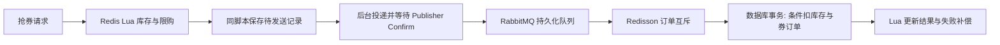

# 宠伴生活：第二阶段改造与验收

本轮目标是保留原工程的技术积累，使简历中的每项功能在宠物业务中有可运行的入口。原 `com.hmdp` 模块、原表与配置继续保留；宠物入口扫描 `com.petcare`，第二阶段组件位于 `com.petcare.platform`，数据表使用 `pet_` 前缀，Redis 使用 `pet:{petcare}:` 命名空间。

## 功能与原有技术对应

| 简历能力 | 宠物业务实现 | 主要代码 |
| --- | --- | --- |
| 双拦截器、Token 滑动续期 | 顾客/店主会话存入 Redis Hash；第一层解析、注入上下文并续期 30 分钟，第二层登录校验；控制器继续校验角色 | `PetWebConfig`、`PetAuth`、`RedisPetSessions` |
| 空值缓存、互斥重建 | 门店详情、服务规格详情复用原 `CacheClient`；不存在记录缓存两分钟，热点冷启动由 SET NX 锁合并回源；规格、门店更新提交后失效缓存 | `CacheClient.queryWithMutex`、`PetCatalog` |
| Redis + Lua 库存与限购 | 限量洗护优惠券；活动时间、库存、一人一券在 Lua 中校验；库存扣减、领取人和待发送记录同一次脚本写入 | `PetCouponService`、`lua/pet-claim.lua` |
| RabbitMQ 异步下单 | 抢券返回 PENDING，后台投递到持久化队列；消费者事务内通过 MyBatis-Plus 条件更新扣库存并写入券订单 | `PetCouponRelay`、`PetCouponConsumer`、`PetCouponMapper` |
| Redisson | 抢券订单消费、活动发布、社交关系与动态推送使用 RLock；不指定 leaseTime，使用 watchdog；数据库唯一约束与条件更新作最终兜底 | `PetPlatformConfig` 及相关服务 |
| 手写 Redis 锁、Lua 释放 | 原 `SimpleRedisLock` 继续用于缓存重建，以进程 UUID + 线程 ID 标识所有者，Lua 比较后释放；修复原 Lua 资源文件大小写不一致 | `SimpleRedisLock`、`unLock.lua` |
| 分布式 ID | 复用原 `RedisIdWorker`，时间统一为 UTC，检查 32 位自增序列范围；用于抢券订单与社区动态 | `RedisIdWorker` |
| GEO 附近门店 | 经纬度、半径与分页校验，Redis GEO 按距离排序，缓存回填门店详情 | `PetCatalog.nearby` |
| ZSet 点赞排行与 Feed 推模式 | 按点赞时间展示最近五位点赞者，动态人气排行，发布后向关注者 ZSet 推送动态；相同时间戳用 max + offset 分页 | `PetSocialService` |
| Set 共同关注 | 关注关系持久化，Redis Set 交集查询共同关注 | `PetSocialService.common` |
| Bitmap 签到 | 上海时区按月记录，每天一位；统计当月累计与当月连续签到 | `PetSocialService.sign` |

大于 JavaScript 安全整数范围的 Long 序列化为字符串，避免订单 ID 在网页中丢失精度。第一层拦截器在请求完成时清理 ThreadLocal，避免线程复用导致用户串号。

## 业务范围

- 原预约流程继续保留：服务规格、连续整点时段、美容师排班、十分钟待支付、三十分钟店主确认、到店核验、完成评价。
- 平台支持多个门店的信息发现与探店关联；当前只有主门店可以在线预约。其他门店详情明确显示“尚未开放在线预约”。
- 优惠券为免费限量领取的满减券，每人每活动一张。店主创建草稿后发布，活动规则不再编辑；预约提交时校验归属、有效期、门店和消费门槛。
- 券的占用、订单折扣和时段占位共用数据库事务；重复请求不能更换优惠券。取消、未支付超时、店主拒单或确认超时均释放优惠券，原有效期不延长。已完成服务的券维持已使用。
- 社区支持昵称、文字动态、可选关联门店、点赞/取消、关注/取消、共同关注、人气动态和关注 Feed。关注时回填最近动态，取消关注后过滤旧 Feed；每位用户的 Feed 最多保留一千条。
- 支付、退款与短信仍是本机演示，不连接真实支付或短信渠道；没有宣称真实交易量、QPS、响应时间提升比例。

## 抢券与故障恢复



Redis 与 RabbitMQ 不共享事务，不能把“Lua 原子执行”说成跨组件原子提交。这里把待发送 ZSet 和请求 Hash 与库存扣减一起写入 Redis，进程在扣库存后退出仍有待发送记录可重试。投递确认超时、连接失败或消息被返回时保留记录；发布确认只证明消息到达代理，不表示数据库落单成功。

消费者提交数据库事务后才更新 Redis 结果并返回；监听器正常返回后由 Spring 自动 ACK。重复投递先读取已有订单，不再次扣库存。业务性失败落为 FAILED 后，Lua 只补偿一次 Redis 库存；瞬时异常则重试。队列通过三次监听器重试与三十秒 TTL 重试队列重新投递，不会把失败消息当成新订单重复写入。接口支持查询异步结果，网页按用户保存待查询编号，刷新后可继续查询。

部署使用独立 Redis 数据库、AOF 与 noeviction；普通进程退出可以恢复待发送任务。Redis AOF everysec 仍可能在主机故障时丢失最近约一秒数据，本项目没有实现跨 Redis 与数据库的强一致灾备，也没有自动修复人为删除部分活动 Redis Key 的功能。活动缓存恢复适用于没有未完成任务的整库恢复；运行中不要手工删除库存、buyers 或 pending Key。数据库库存条件和唯一约束可以防止最终超卖与重复发券。

社区动态与数据库推送任务同事务提交，后台以相同 ZSet member 幂等推送，失败任务保留。关注、点赞以数据库为关系事实，Redis 提供集合与排行查询；操作可重复提交修复投影，空缓存可从数据库重建。

相关语义参考：[RabbitMQ 确认机制](https://www.rabbitmq.com/docs/confirms)、[Redis Lua 执行语义](https://redis.io/docs/latest/develop/programmability/eval-intro/)、[Redisson 锁与 watchdog](https://redisson.pro/docs/data-and-services/locks-and-synchronizers/)。

## 启动

完整技术栈推荐方式：

```powershell
Copy-Item .env.example .env
# 编辑 .env：设置数据库、RabbitMQ、店主密码；这些本地配置已被 Git 忽略。
docker compose up -d --wait
.\start-pet.ps1 -MySql
```

`.env` 只支持 `PET_NAME=literal-value` 赋值；不会执行其中内容。启动脚本读取它，已经设置的环境变量优先。Compose 默认 MySQL 13306、Redis 6379、RabbitMQ 5672；只绑定本机。`.env.example` 已匹配 Compose 的数据库名、用户、端口和虚拟主机。

连接已有中间件时可不使用 Docker，按 `.env.example` 设置连接信息再运行。最低使用 Redis 5，实际默认 Compose 为 Redis 7.4、RabbitMQ 4.1、MySQL 8.4。保留原 Java 依赖版本，不在本轮做 Spring Boot 大版本迁移。

```powershell
.\start-pet.ps1          # H2 + 真实 Redis/RabbitMQ，完整第二阶段
.\start-pet.ps1 -MySql   # MySQL + 真实 Redis/RabbitMQ
.\start-pet.ps1 -Demo    # 第一阶段预约演示，无中间件
```

顾客网页默认端口 8081，店主工作台 `/owner.html`。首次创建三个杭州示例门店、一项三十张的活动和两条社区动态；示例手机号 `13800000001` / `13800000002` / `13800000003`。已有活动过期后由店主新建，重启不会重置库存或重复发券。

## 接口索引

公共前缀 `/api/pet`；受保护接口使用 `Authorization: Bearer <token>`。原预约接口继续使用。

| 接口 | 用途 |
| --- | --- |
| GET `/capabilities` | 当前模式和平台名称 |
| GET `/places?longitude=&latitude=&radius=&page=`、`/places/{id}` | 附近门店、缓存详情 |
| GET `/services/{id}` | 缓存服务规格详情 |
| GET `/coupons`、`/coupons/{id}` | 已发布活动 |
| POST `/coupons/{id}/claim` | 领取，返回券订单编号与 PENDING 状态 |
| GET `/coupon-orders/{id}`、`/my-coupons` | 本人抢券结果与券包 |
| POST `/orders`，可选 `couponOrderId` 字符串 | 预约并占用优惠券 |
| GET/POST `/owner/coupons`、POST `/owner/coupons/{id}/publish` | 店主草稿及发布 |
| GET/POST `/community/posts`、GET `/community/posts/{id}` | 动态列表、发布与详情 |
| PUT `/community/posts/{id}/like`，`{"liked":true}` | 设置点赞状态，重复调用幂等 |
| GET `/community/posts/{id}/likers`、`/community/hot` | 最近点赞者与人气动态 |
| GET/PUT `/community/me` | 本人资料与昵称 |
| GET `/community/members/{id}/profile` | 公开资料，不返回手机号 |
| PUT `/community/members/{id}/follow`，`{"following":true}` | 设置关注状态 |
| GET `/community/members/{id}/common` | 共同关注 |
| GET `/community/feed?max=&offset=` | 关注动态，使用响应中的 max/offset 获取下一页 |
| GET/POST `/sign` | 查看/执行签到 |

## 验证

```powershell
.\verify-pet.ps1
.\verify-pet.ps1 -Platform -RedisPort 16379
.\verify-pet.ps1 -Broker -RedisPort 16379 -RabbitPort 5672 -RabbitVhost /petcare-test
cd qa
npm ci
npm test
npm run test:platform
```

第一条只验证预约与打包；Platform 测试必须提供独立 Redis，使用其 15 号数据库，Broker 测试使用 14 号数据库及独立 RabbitMQ 虚拟主机。它们会清理自己的 `pet:{petcare}:` 测试 Key；禁止连接平台运行中的数据库或虚拟主机。

浏览器脚本默认连接本机 8081，可设置 `PET_BASE_URL`，使用本机 Chrome，可设置 `PET_CHROME_PATH`。截图和结果写入 `.local-backups/browser-results` 与 `.local-backups/browser-platform`。本轮验收结果记录在 `docs/petcare-stage2-verification.md`。
