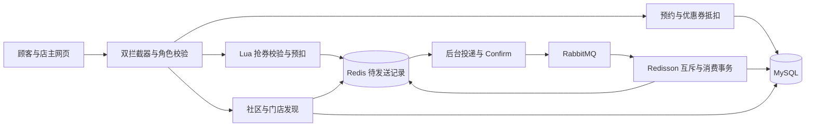

# 宠伴生活 Java 后端实习面试问答手册

更新日期：2026-10-21。适用项目：**宠伴生活 · 宠物服务与交流平台**。源码基线为已上传的 [66b62cd](https://github.com/zl-60/dianping-changFindLive/commit/66b62cddd7d8f288c7c9f6a785de1f41020eb4b1)。本文围绕第二轮真实实现准备面试，包含 **84 个问题及答案**，兼顾业务、技术原理、代码位置和常见追问。

建议先做到“能介绍业务、能画完整链路、能解释失败窗口”，再补充八股。文中的口述模板用于组织表达，实际经历请按自己的参与情况调整。“已实现”以当前源码为准；标为“改进”的内容不能直接写成已完成功能。

## 阅读顺序

| 顺序 | 内容 | 问题范围 | 准备目标 |
| --- | --- | --- | --- |
| 第一轮必会 | 项目介绍、预约、抢券与 MQ | Q01–Q06、Q13–Q21、Q29–Q46 | 能完整回答主链路与异常处理 |
| 高频追问 | 登录、缓存、分布式锁、ID | Q07–Q12、Q22–Q28、Q47–Q52 | 能解释为什么这样设计及限制 |
| 功能展开 | 社区、Feed、GEO、Bitmap | Q53–Q60 | 技术名词能对应业务和 Redis 命令 |
| 基础知识 | Spring、MyBatis、MySQL、Java、JVM | Q61–Q80 | 从项目问题延伸到原理 |
| 面试收尾 | 测试、性能、改造与演示 | Q81–Q84 | 有证据、有取舍，不编造指标 |

如果只有一天：优先 Q01、Q13–Q21、Q24–Q26、Q29–Q38、Q41–Q45、Q48–Q52、Q61–Q66、Q81–Q84。

## 一 项目介绍与业务范围

### Q01 请用一分钟介绍这个项目

**参考回答：** 宠伴生活是一个基于 Spring Boot 的宠物服务与交流平台，基于原点评学习工程做了两轮改造。顾客可以发现附近宠物门店、领取限量洗护券、预约服务并到店核验，也可以发布养宠动态、点赞关注和签到；店主管理服务规格、美容师、排班、预约订单和优惠券活动。

技术上，我重点准备三条链路：一是用数据库事务、资源占位和唯一约束保证预约不冲突；二是用 Redis + Lua 做抢券资格校验和预扣，RabbitMQ 异步落单，Redisson 与数据库约束处理重复消费；三是用 Redis 缓存、ZSet、Set、GEO 和 Bitmap 支撑门店查询和社区功能。

**必须主动说清：** 当前在线预约履约只支持主门店；其他门店用于发现和探店关联。短信、支付、退款是演示，没有真实交易数据或线上 QPS。

### Q02 这和原来的黑马点评有什么区别 只是改名吗

**回答要点：** 要承认学习来源，再讲真实新增业务和工程闭环。原项目积累了缓存、秒杀、Redis 数据结构等实现；本轮保留原 `com.hmdp` 模块，在 `com.petcare` 中接入宠物业务，没有把学习项目包装成商业原创。

有实质差异的内容包括：按美容师能力、排班和服务时长预约；订单超时占位与履约状态约束；优惠券和预约的事务内抵扣、取消退回、历史快照；可恢复的待发送记录、发布确认、幂等消费与单次补偿；顾客端和店主端的完整页面及自动化验证。

**追问“你最熟悉哪部分”：** 选两条真正能展开代码的链路，例如“优惠券预扣到异步落单”和“多小时预约与取消退券”。能讲清边界，比罗列七个中间件更有说服力。

### Q03 项目是单体还是微服务 为什么同时有 JdbcTemplate 和 MyBatis Plus

**答案：** 这是同一 Maven 工程内的单体应用。默认入口是 `PetApplication`；原点评入口保留用于学习与对照，不能把两个入口说成已经拆分并通信的微服务。

第一轮预约业务使用 JdbcTemplate，便于直接表达时段占位与事务；第二轮抢券通过 MyBatis-Plus 的 `UpdateWrapper` 执行条件扣库存。两种持久化方式可以共存，关键是共享同一 DataSource 和 Spring 事务管理器。当前没有为了统一 ORM 推翻已有预约逻辑，也没有实现多数据源分布式事务。

版本要说准确：Spring Boot 2.3.12、MyBatis-Plus 3.4.3、Redisson 3.13.6；编译目标 Java 8。本机用 JDK 25 运行验证，不代表使用了 Java 25 的语法或 Spring Boot 3。

**源码：** [pom.xml][pom]、[PetApplication][app]、[PetCouponConsumer][consumer]。

### Q04 顾客 店主和美容师分别能做什么

**答案：** 顾客负责查看门店、选服务和时间、填写宠物信息、下单、模拟支付、取消与评价，以及社区和抢券。店主负责维护服务、人员能力与排班，确认或拒绝预约，到店核验、开始和完成服务，处理取消和活动发布。

美容师是被排班和分配的服务资源，当前没有独立账号和操作端。项目也没有独立宠物档案系统：一笔预约保存一只宠物的信息快照。联系手机号与登录手机号可以不同，但订单归属始终取自服务端登录身份，不能由客户端指定。

**面试价值：** 这能解释为什么既需要“是否登录”，也需要“是否为店主”和“是否为订单本人”三种不同校验。

### Q05 最重要的业务表与约束有哪些

| 表 | 作用 | 关键约束或关联 |
| --- | --- | --- |
| `pet_order` | 预约及价格、宠物、联系人快照 | `UNIQUE(user_phone,request_key)`，预约码唯一 |
| `pet_slot` | 美容师每个整点的占用 | 主键 `(staff_id,slot_start)` |
| `pet_shift` | 员工每日排班 | `UNIQUE(staff_id,work_date)` |
| `pet_coupon` | 活动规则与数据库库存 | 活动时间、优惠门槛、有效期 |
| `pet_coupon_order` | 抢券结果和使用状态 | ID 主键，`UNIQUE(user_id,coupon_id)` |
| `pet_coupon_use` | 当前预约占用的优惠券 | 订单主键，券订单 ID 唯一 |
| `pet_coupon_history` | 预约原请求的优惠券快照 | 订单主键，取消后仍保留 |
| `pet_follow` / `pet_like` | 关注与点赞事实 | 关系双方的联合主键 |
| `pet_social_task` | 待推送动态任务 | 与动态同事务创建，完成后标记 |

**答案逻辑：** Java 校验负责返回友好的错误，数据库唯一约束负责并发兜底。先查没有记录再插入，仍可能同时被两个请求执行；唯一索引才能阻止最终重复。

**源码：** [pet-schema.sql][schema]。

### Q06 面试官让你画架构图 你会画什么

先画业务经过的组件，再解释每条箭头成功和失败分别意味着什么。



**展开回答：** Redis 在这里既承担缓存和会话，也保存尚未完成的抢券任务、签到和社交投影，因此不能把所有 Redis 数据都按“可随时清空的缓存”处理。MySQL 保存最终券订单、预约和关系事实。MQ 将受理与数据库创建订单解耦，但引入重复投递和最终结果查询，需要幂等及恢复机制。

## 二 登录会话与接口权限

### Q07 双拦截器分别做什么 顺序为什么重要

**答案：** 第一层是用户上下文刷新：读取 Bearer Token，从会话存储加载用户，把身份放入请求属性和 ThreadLocal，并刷新有效期；没有有效 Token 时允许继续，让匿名用户仍能浏览公开接口。第二层判断当前路径是否允许匿名访问，对受保护接口检查第一层是否已注入身份，没有则返回 401。

这个顺序让登录限制依赖已解析的身份，也让公开页面上的已登录用户获得续期。第一层不应该一看到无 Token 就拦截所有请求，否则无法匿名浏览；第二层也不负责重复查询 Redis。具体角色与资源归属仍由控制器/业务层判断。

**源码：** [PetWebConfig][web] 的 `Refresh`、`Login`，以及 [PetAuth][auth] 的 `resolve`、`require`。原简历“先校验登录、后注入身份”的顺序需要改正。

### Q08 Token 自动续期怎么实现 已经过期还能续吗

**答案：** Redis 会话是 Hash，保存 `subject` 和 `role`，创建时用 Lua 一起设置内容与 1800 秒 TTL，避免只写内容却忘记过期时间。请求携带合法且仍存在的 Token 时，加载会话并把 TTL 重置为三十分钟，这叫请求驱动的滑动过期。

已经失效或被删除的会话不能靠旧 Token 重新创建。没有请求时不会后台无限续期。本项目没有额外的 refresh token，也没有“距离过期五分钟才刷新”的阈值；当前是每次成功解析都刷新。

**追问：** 续期会增加 Redis 命令量，可改为仅在剩余 TTL 较小时刷新，但要处理判断与更新的竞争。注销会删除会话，不过已完成身份校验的并发在途请求不保证被瞬间撤销。

**源码：** [RedisPetSessions][sessions]。

### Q09 为什么用 ThreadLocal 为什么必须 remove

**答案：** ThreadLocal 让同一请求线程内的代码方便读取当前用户，避免层层传参。它不是全局线程安全容器，也不会把身份自动传入异步线程。

Web 容器复用工作线程，如果请求结束不清理，下一个请求可能读到前一个用户的身份；同时 ThreadLocalMap 的 Entry 虽然弱引用 key，但 value 是强引用，长寿命线程里未清理的 value 可能滞留。当前刷新拦截器请求开始先 clear，完成时再 `remove()`，并使用请求属性辅助保存身份。

**追问：** 新建线程和 MQ 消费线程不能直接依赖请求 ThreadLocal。异步任务只传必要的业务 ID，并重新开启自己的事务；不要简单用 InheritableThreadLocal 给线程池传播用户，线程池复用会使继承时机失真。

### Q10 为什么选 Redis Token 而不是 JWT 和 HttpSession

**答案：** 当前是随机不透明 Token，服务端 Redis 保存会话。优点是多实例共享、主动注销和权限信息变更较直接，代价是每次解析依赖 Redis。Token 本身不是自包含的用户数据，也没有 JWT 签名校验过程。

HttpSession 也可以通过共享会话方案适配多实例，并不是一定只能单机。JWT 可以离线验证签名，降低中心化查询，但需要设计有效期、撤销、刷新与密钥轮换；如果每次仍查黑名单，就不是完全无状态了。JWT 的载荷通常只是编码，不应直接放密码等敏感信息。

**追问“哪个更安全”：** 取决于威胁模型与实现。共同要求包括 HTTPS、足够随机性、合理有效期、避免日志泄露和防止客户端脚本窃取 Token。

### Q11 登录之后为什么还可能返回 403 怎么防止越权

**答案：** 认证回答“你是谁”，授权回答“你能做什么”。无有效登录通常返回 401；已经登录但角色或资源归属不满足，返回 403。

店主管理接口调用 `require(request,"OWNER")`，顾客业务要求 CUSTOMER。查询本人订单和券结果时，服务端根据会话身份得到用户，再与记录的所有者比较，不能接受客户端传来的 userId 作为授权依据。顾客即使猜到别人的订单 ID，也不能查看、支付、取消或用其优惠券。

**追问：** 随机 ID 或长整型 ID 只能降低枚举便利度，不能替代归属校验。前端隐藏按钮、CORS 限制都不是后端权限控制。

### Q12 验证码和店主密码有哪些防护 还有什么边界

**答案：** 验证码由 SecureRandom 生成，数据库保存摘要、五分钟期限与错误次数；同手机号一分钟内不能重复获取，成功后删除，最多允许五次错误。错误次数需要真实提交，所以该登录方法对业务异常不回滚，避免攻击者通过不断输错获得无限机会。

店主密码用带随机盐的 PBKDF2WithHmacSHA256 验证，当前配置迭代 120000 次，并限制同一来源 IP 的失败尝试。随机盐与慢哈希降低预计算和暴力枚举效率，不能用“MD5 加密”替代这个解释；哈希也不是可解密的加密。

**真实边界：** 验证码仍是本机演示，直接返回演示码；店主密码来自配置，校验摘要在进程中构建；IP 限制存在进程内，多实例时没有共享限制。这不是完整生产账号体系。生产还需要真实短信、分布式频控、密钥管理与审计。

## 三 预约订单与优惠券使用

### Q13 宠物预约的库存为什么不是一个整数

**答案：** 预约资源是“有对应能力的美容师，在完整服务时长内的连续空闲时间”。例如大型犬洗澡需要两小时，预约 14:00 开始，就必须找到同一位员工同时覆盖 14:00 和 15:00 两个整点，不能把两个人各一小时拼起来。

系统检查员工启用、能力匹配、当日排班覆盖、所有整点未被占用、门店营业时间，以及未来七天内至少提前两小时。种类与体重也必须匹配服务规格，当前体重区间是 `(minWeight,maxWeight]`。

占用采用左闭右开区间 `[start,end)`：14:00–16:00 占 14:00、15:00，不占 16:00，下一单可以从 16:00 开始。当前选择符合条件且 ID 最小的员工，没有实现智能负载均衡。

**源码：** [PetBookingService][booking] 的 `validateTime`、`availableStaff`、`occupy`。

### Q14 页面明明显示有空位 为什么提交时仍可能约满

**答案：** 查询可用时间只展示查询那一刻的状态，不为用户保留资源。用户填写信息的过程中，其他人可能已经下单，因此真正创建订单时必须在事务与资源锁保护下再次检查并占位。

若查询时立即占位，大量只浏览、不提交的用户也会消耗资源，还需要额外的临时预占、释放、用户限额和过期机制。本项目把资源承诺放在提交成功之后：成功后保留十分钟用于支付。前端再次检查只能改善体验，最终正确性依赖后端提交时校验。

**追问“改成半小时怎么办”：** 把资源粒度调整为半小时，并保证服务时长可以映射为整数粒度；占用记录会增多。若允许任意区间，可用 `old.start < new.end AND old.end > new.start` 判断重叠，但仍需要并发协调，不能只查询没有冲突就插入。

### Q15 两个人同时抢最后一个预约时段 如何保证只有一个成功

**答案：** 创建预约在有效数据库事务内，先对固定 `pet_lock` 行执行 `SELECT ... FOR UPDATE`，然后清理过期记录、检查完整时段、插入订单和占位。第二个请求等待锁释放后再检查，会看到第一个已占用资源。

数据库还有 `(staff_id,slot_start)` 主键兜底，阻止同一员工同一整点重复占用。订单插入和多个小时占位在一个事务内，数据库异常不能留下“订单存在但部分小时没有占住”的结果。

**追问：** 锁必须处于有效事务中，自动提交模式下单独执行后锁会很快释放，保护不了后续操作。`synchronized` 只能约束单个 JVM，无法代替多实例共享的数据库锁。

**源码：** [PetData.lock][data]、[PetBookingService.create][booking]、[表结构][schema]。

### Q16 为什么锁整家店 会不会太粗 有什么优化方向

**答案：** 当前是主门店预约，资源写操作先锁同一行，把排班调整、换人、取消、占位等复杂竞争串行化，便于建立一致的业务约束。正确性比较直观，代价是独立员工、不同日期的操作也会相互等待，所以不适合直接宣称大规模高吞吐。

**改进方案：** 可以按门店或员工日期拆锁，缩小事务；如果一次操作涉及多名员工或多天资源，需要统一加锁顺序，避免死锁。还要让排班修改、换人与下单遵守同一锁协议，不能只优化创建订单这一个入口。

数据库唯一约束仍要保留，因为应用锁可能遗漏或失效。是否拆分应看真实锁等待、业务规模与复杂度，而不是看到“粗锁”就无条件换成 Redis 锁。

### Q17 预约事务为什么设置 noRollbackFor 这不是有风险吗

**答案：** `PetException` 是运行时业务异常，但预约服务显式设置 `noRollbackFor=PetException.class`。原因是很多操作先清理已经过期的订单，再判断本次请求；即使本次请求被拒绝，也希望前面的过期清理提交。验证码错误次数有类似需求。

这个选择有明确代价：排除的是整个事务中的该类异常，不是只排除清理步骤。若未来先写订单、再抛 PetException，可能提交部分业务数据。因此当前尽量把可能失败的参数、资源与优惠券校验放在新增写入之前，真正数据库冲突使用会回滚的异常。

**改进方案：** 对清理和本次业务拆分事务边界，或细分异常；必要时通过独立 Bean 的 REQUIRES_NEW 清理，但要分析锁竞争与业务原子性。不能简单说“加上事务后所有异常都回滚”。

### Q18 用户重复点提交或网络超时后重试 怎么防止重复预约

**答案：** 客户端为一次业务操作生成稳定的 requestKey，重试继续使用同一个值。服务端按 `user_phone + request_key` 查找，存在且内容一致就返回原订单；同一个 key 携带不同规格、时间、宠物、联系人或优惠券时返回冲突，防止用同一幂等键表达两个意图。

数据库联合唯一约束作最后兜底。前端禁用按钮只能减少误操作，网络重试、多个标签页或恶意请求仍可绕过，不能替代服务端幂等。

**追问：** 每次重试都生成新 key 会失去幂等效果。幂等也不是返回完全相同的原始响应字节，而是同一操作不会重复产生业务效果；返回的订单状态可以已经从待支付变成已取消。

### Q19 订单有哪些状态 十分钟关单真的是 MQ 延迟消息做的吗

**答案：** 主状态为 UNPAID → PENDING → CONFIRMED → ARRIVED → IN_SERVICE → COMPLETED，允许的阶段可转为 CANCELLED。支付、确认、到店、开始、完成各自校验前置状态，重复操作在允许情况下返回现有结果，不能随意跳转。

未支付十分钟、支付后三十分钟未确认，通过数据库 deadline、每十五秒后台清理及相关业务操作前清理实现。支付操作也先校验/清理，所以调度暂时迟到，不意味着过期订单仍可付款。

本项目的 RabbitMQ 三十秒 TTL 队列用于抢券消费重试，不是预约关单队列。定时任务也不保证到期瞬间执行，业务状态判断才是最终依据。

**源码：** [PetExpiry][expiry]、[PetBookingService][booking] 的 `pay`、`action`、`expireLocked`。

### Q20 优惠券如何和预约在同一事务中使用 为什么不能相信前端金额

**答案：** 抢券订单和预约订单是不同对象。创建预约时，服务端读取实际规格价格，锁定并检查券订单，校验是否本人、SUCCESS 状态、主门店、未过期和满足门槛，然后创建预约、把券改成 USED、插入活动占用与历史快照、更新实付价格并占用时段，整个过程在同一数据库事务中完成。

例如洗护 69 元，券满 69 减 20，服务端计算实付 49 元；客户端即使提交 1 元也不能改变定价。优惠金额不超过原价，所有计算使用分为单位的整数。

**追问：** `PetCouponUse` 自身不需要再开启一个独立事务，调用时加入预约服务已有的事务即可。若把券操作改到 Redis 中，就不能再依靠这个本地数据库事务保证券与预约同时提交，需要新的预占/确认/补偿协议。

### Q21 取消后怎么退券 为什么还要单独保存 coupon history

**答案：** 取消预约、释放时段、恢复券状态和删除当前券占用记录在同一事务中完成。券从 USED 恢复 SUCCESS，清空所绑定的预约 ID，原有效期不延长。已付款的退款仍是状态模拟，不能描述成真实支付渠道退款。

`pet_coupon_use` 记录当前有效占用，券 ID 唯一，所以取消后要删除，才能给下一笔预约使用。`pet_coupon_history` 记录原预约请求使用过哪张券以及原价和折扣，取消后不删除。

如果只有活动占用表，取消后删掉记录，再用原 requestKey 重试原请求，就无法判断“原来确实用了这张券”，容易误报请求内容改变。历史表保留了幂等比较依据，也让取消订单继续展示折扣快照；它不阻止同一张已退回券在后续预约中使用。

**源码：** [PetCouponUse][couponuse] 的 `sameRequest`、`check`、`use`、`release`。

## 四 Redis 缓存与一致性

### Q22 门店和套餐为什么要缓存 缓存的读取流程是什么

**答案：** 门店详情和服务规格是访问相对频繁、变更相对少的公开数据，适合用缓存降低重复回源。当前 `PetCatalog` 调用复用后的 `CacheClient.queryWithMutex`，先 GET：有 JSON 就反序列化返回，命中空字符串就返回不存在，真正没有 Key 才尝试加锁、查数据库并回填。

门店详情通常缓存十五分钟，规格十分钟，不存在记录两分钟。订单创建仍重新读取数据库规格并校验资源，不能把可能陈旧的展示缓存当成最终价格和库存依据。

**追问“整个查询完全不访问数据库吗”：** 不能这样说。单条详情可以命中缓存，但当前服务列表仍先查规格列表，抢券还查活动与用户映射；要结合真实调用路径回答，不把某个 CacheClient 命中等同于全链路零数据库访问。

### Q23 缓存穿透 击穿和雪崩有什么区别 项目做了哪些

**答案：** 穿透指反复查询根本不存在的数据，每次都回源；本项目用短期空值缓存应对。击穿指某个热点 Key 失效，大量请求同时回源；本项目用互斥重建和锁内二次检查合并回源。雪崩指大量缓存同时失效或 Redis 整体不可用，造成大面积回源压力。

当前没有实现完整的雪崩防护、统一限流熔断或自动降级。TTL 加随机偏移、分批预热、热点保护、数据库并发限额都可以作为改进，不能直接说已经上线。

**追问：** 过期时间随机化能分散集中失效，不能解决 Redis 整体宕机。空值缓存也需要区分数据库异常和确实不存在，不能把查询失败当作不存在长期缓存。

### Q24 互斥重建为什么加锁后还要再查一次缓存

**答案：** 请求 A、B 都在第一次 GET 时未命中。A 先获得锁，完成回填并释放；B 随后获得锁。如果 B 不再检查，就仍然查询数据库，锁只是让重复查询排队，没有真正合并回源。

当前流程是“GET → 尝试 SET NX 锁 → 再 GET → 数据库查询 → 回填 → Lua 解锁”。未获得锁的请求短暂等待后重读缓存，最多尝试一百轮，每轮二十毫秒，避免无限等待。

**限制：** 锁租约十秒，数据库重建若超过租约，可能出现新的重建者；当前没有给这个手写锁自动续期。互斥也不意味着缓存永远一致，后面仍有更新与回填竞争。面试时要区分正常路径保护和异常时的保证边界。

**源码：** [CacheClient][cache] 的 `queryWithMutex`。

### Q25 SETNX 为什么要同时设置过期时间 为什么解锁还要 UUID 和 Lua

**答案：** `SET key owner NX EX ttl` 一次完成“仅不存在时写入”和租约设置。如果先 SETNX 再单独 EXPIRE，进程可能在中间退出，留下没有过期时间的锁。

锁值需要标识所有者。A 的锁过期后 B 已重新拿到锁，A 恢复执行时不能直接 DEL，否则会删除 B 的锁。先 GET 再由 Java 判断后 DEL 也有竞争窗口，因此用 Lua 在服务端完成“值仍属于我才删除”。当前所有者是进程 UUID 加线程 ID，测试覆盖了旧持有者不能删除新持有者的情况。

**不能扩大承诺：** 比较后删除防止误删，不会阻止租约过期的旧持有者继续修改数据库；后者需要业务约束或 fencing 等机制。

### Q26 更新缓存为什么先更新数据库 再删除缓存 有什么漏洞

**答案：** 先更新数据库，再在事务提交后删除缓存，可以让后续请求从新数据重建。若先删缓存再写数据库，另一个请求可能在数据库更新前读到旧值并重新写入缓存，旧值就继续保留。

当前用事务提交后的事件监听执行失效，避免数据库还未提交就让读者重建旧数据。但 Cache Aside 仍有两个窗口：数据库已提交而 Redis 删除失败；旧的慢查询在删除之后又把旧值回填。TTL 会限制部分陈旧数据的存活时间，但不能据此宣称强一致。

**改进方案：** 根据一致性要求增加可靠失效任务、变更日志订阅、版本校验或控制读写重建顺序。简单延迟双删也不是无条件正确：延迟多久取决于并发与查询耗时，第二次删除本身仍可能失败。

**源码：** [PetCatalog.invalidate][catalog]、[PetCatalogChanged][cacheevent]。

### Q27 为什么不用布隆过滤器或逻辑过期

**答案：** 当前门店和规格数量较少，短期空值缓存足以覆盖演示场景，没必要只为堆技术引入过滤器。布隆过滤器适合大量合法 ID 的快速存在性判断：可能把不存在判断为可能存在，正确维护时不会把已加入元素判断为不存在；它不返回具体数据，删除和同步也需要设计。

逻辑过期适合允许短期旧数据的热点内容：缓存保存逻辑过期时间，到期仍返回旧值，后台互斥刷新，可以减少等待。代价是用户可能看到陈旧数据，需要预热和重建失败处理。原工具类保留了相关学习代码，但当前宠物详情实际接入的是互斥重建，不能把保留的方法说成主链路正在使用。

### Q28 Redis 挂了怎么办 直接全部查数据库可以吗

**答案：** 要按数据职责区分。公开门店详情这类可重建缓存可以考虑有并发上限的数据库降级；直接让所有请求无控制回源，可能把数据库拖垮。抢券库存、pending、会话和签到并不都是可随意丢弃的缓存，不能 Redis 一失败就默认抢券成功或跳过登录。

当前平台模式依赖真实 Redis，没有完整熔断、限流或高可用切换；依赖不可用会影响相应功能。这是现状。生产改进应明确关闭哪些写入口、保留哪些只读能力、设置什么并发限额，并配合 Redis 持久化、监控和恢复校验。

**追问：** Redis 的 noeviction 是避免主动淘汰关键业务 Key，不是永不失败；达到内存上限后，新增写操作可能被拒绝。

## 五 优惠券秒杀主链路

### Q29 从点击抢券到券进入券包 请完整讲一遍

**答案：** 首先校验顾客身份和活动，生成业务订单 ID；Lua 在 Redis 内检查活动时间、库存和一人一券，成功则预扣库存、记录买家、写请求 Hash 和待发送 ZSet。接口返回订单 ID 与 PENDING，说明请求被受理，不是已经拿到最终优惠券。

后台 Relay 扫描到期任务，发送只包含订单 ID 的持久化 RabbitMQ 消息，检查 Confirm 和 return。消费者按订单 ID 获取 Redisson 锁，在数据库事务内先查是否已有结果，再执行条件扣库存与券订单插入。事务提交后用 Lua 更新请求结果，失败时单次补偿 Redis，完成后移除 pending，监听方法正常返回再由容器 ACK。

网页查询本人订单结果，数据库 SUCCESS 后进入券包，使用时再与预约事务关联。当前控制器使用普通成功 JSON 返回，并没有实现 HTTP 202 专用响应，面试不要把接口状态码说成已改成 202。

**源码：** [PetCouponService][coupons]、[抢券 Lua][claimlua]、[Relay][relay]、[Consumer][consumer]。

### Q30 为什么用 Lua 原子执行到底保证什么 报错会回滚吗

**答案：** 如果客户端分别 GET 库存、判断、DECR，两个请求可能同时读到最后一张。Lua 让这些 Redis 操作在服务端连续执行，其他客户端命令不能在脚本中间穿插，并减少网络往返。脚本应短小，因为长时间执行会阻塞同实例其他操作。

**关键边界：** 原子执行不等于运行时异常自动回滚，更不等于 Redis、RabbitMQ、MySQL 的跨组件事务。比如 DECR 已成功，后面的 HSET 因 Key 类型错误失败，之前的扣减不会自动撤销。

当前脚本做了业务前置检查并明确返回 0，但没有对所有待写 Key 完整 TYPE 预检，不能回答“任何异常都会自动恢复”。可改进为更完整的类型/参数校验、隔离命名空间、告警与对账。[Redis 官方执行语义](https://redis.io/docs/latest/develop/programmability/eval-intro/)、[回滚边界](https://redis.io/blog/you-dont-need-transaction-rollbacks-in-redis/)。

### Q31 为什么 Lua 的 Key 通过 KEYS 传递 共同 hash tag 有什么用

**答案：** Redis 要求脚本声明自己访问的 Key，业务参数通过 ARGV 传递，不应把业务 ID 拼在 ARGV 中再任意访问未声明的 Key。当前库存、买家、请求、pending 和活动元数据都显式列入 KEYS。

Redis Cluster 中，多 Key 操作通常要求相关 Key 位于同一个槽，`pet:{petcare}:...` 的共同 hash tag 让这些 Key 可以规划到同槽。注意当前连接是单节点模式，使用 hash tag 不代表已经部署并验证了 Redis Cluster；所有业务放同一槽还会形成热点，不能把它当成自动水平扩展方案。

**追问：** 若按活动设置不同 hash tag，跨活动共享的 pending 结构也需要重新分片设计，不能只改库存 Key。

### Q32 Redis 已经扣库存 为什么 MySQL 还要扣一次

**答案：** Redis 预扣用于快速竞争资格和削减后续写压力，MySQL 保存最终发券事实。两边不共享事务，Redis 数据可能因恢复、误操作或异常不同步，数据库仍需用条件更新防止最终库存变为负数。

```sql
UPDATE pet_coupon
SET stock = stock - 1
WHERE id = ? AND published = 1 AND stock > 0
  AND starts_at <= ? AND ends_at > ?;
```

Java 必须判断影响行数，只有一行更新成功才创建 SUCCESS。这里用的是受理时间，避免仅因消费排队跨过活动结束就无条件拒绝合法受理请求。事务保证库存变化和券订单一起提交。

**追问“是不是两次减同一个库存”：** 是两套状态各自减一次，不是在同一张库存上扣两次。也不能说请求完全不访问 MySQL：当前入口还有活动和用户信息读取，若追求峰值性能，可缓存不可变活动规则并减少用户映射查询，这属于下一步优化。

### Q33 一人一券在哪几层实现 先查没有就能插入吗

**答案：** Redis 的 buyers Hash 用用户 ID 映射到该活动的订单 ID，Lua 在扣库存前检查它，避免同一用户反复占用资格。数据库使用 `UNIQUE(user_id,coupon_id)` 兜底，订单 ID 主键处理同一消息重复。

“先 SELECT 不存在，再 INSERT”不是充分条件，因为两个事务都可能查到不存在。当前 Redis 正常路径先完成用户去重，消费者按订单 ID 互斥，再由数据库约束守住最终不变量。锁和预检查主要减少冲突，约束才是持久化层不能被绕过的限制。

**追问：** 唯一键冲突应识别为重复操作或状态不一致，不能把所有数据库异常都当成成功；要检查原结果与当前业务含义是否一致。

### Q34 同一个用户重复抢同一张券 为什么返回原订单 ID

**答案：** 用户网络超时后不确定第一次是否被受理，直接返回“重复请求失败”会让他误以为没有领取。当前 Lua 检查到 buyers 已有映射，Java 查询并返回那个订单的 PENDING、SUCCESS、USED 或 FAILED 结果，给用户一个稳定的查询入口。

这也避免重复请求消耗额外库存。ID 生成在 Lua 之前，所以有些新生成 ID 最后不会被使用，这种间隙是正常的；分布式 ID 的要求是唯一性等业务属性，不是每个号码连续出现。

**边界：** 当前 FAILED 仍保留 buyers 映射，同一用户重试会得到原失败结果。库存补偿是恢复可分配数量，不等于自动赋予这个用户一次全新的领取机会。

### Q35 Redis 扣成功但进程在发送 MQ 前退出 怎么办

**答案：** 预扣脚本在正常完成时，同时把请求 Hash 和待发送 ZSet 写好，Relay 由后台独立扫描。Java 进程在扣完库存、还没发消息时退出，下次启动仍能从 Redis 找到任务并投递，前提是这些记录已经保留下来。

这不是 MySQL outbox 表方案。这里的可靠基础在 Redis，而 Redis 自己有持久化和恢复边界。AOF everysec 在主机故障下仍可能损失最近约一秒写入；手动清空 Redis、错误淘汰或部分删除 Key，也不是普通进程重启能够自动修复的情形。

**改进方案：** 视业务要求选数据库 outbox、可靠日志或更完整的预占对账协议。不能一句“用了 MQ”就声称消除了所有扣库存到发消息的窗口。[Redis 持久化说明](https://redis.io/docs/latest/operate/oss_and_stack/management/persistence/)。

### Q36 pending ZSet 的 score 是什么 为什么收到 Confirm 后不立即删除

**答案：** score 表示下一次允许投递的时间。新受理时写入当前时间，Relay 每秒扫描到期任务，一次最多五十个。确认发送并且没有 return 后，下一次投递时间向后推三十秒；最终删除由消费者完成。

因此 Confirm 只证明生产者到 Broker 这一段达到相应确认条件，不证明订单已提交。若消费者长时间没有完成，保留 pending 可以再次投递，但也会产生重复消息，所以消费必须幂等。

**竞态追问：** 消费者可能比发送方更早完成并删除 pending。Relay 若直接 ZADD 会把已完成任务重新加回来；当前用 Lua 先检查 request 仍为 PENDING，才修改下次投递时间，否则移除，避免这种“完成后复活”。

### Q37 消费者如何幂等 为什么数据库事务比单纯捕获重复主键重要

**答案：** 消费者先按订单 ID 互斥，然后在事务中查询已有券订单。如果已经有 SUCCESS、USED 或 FAILED 结果，就复用结果，不再扣库存；没有才条件扣库存并插入结果。数据库主键和用户活动唯一约束继续兜底。

事务是关键：若库存扣减和订单插入各自提交，可能第一次已经扣库存但插单失败，重试又扣一次；或订单先落了、库存没扣，后续重试被重复主键挡住却无法修复。当前 TransactionTemplate 把两步绑定为一个数据库事务。

数据库提交之后 Redis 更新失败，可以重试：已有订单证明前面的数据库工作已完成，只需继续更新 Redis。不能对这种异常直接恢复 Redis 库存，否则数据库已经发券却又释放资格，会破坏一致性。

### Q38 库存补偿什么时候做 怎样避免补偿两次

**答案：** 只有消费者把业务结果明确持久化为 FAILED，例如数据库库存不足或活动条件不成立，才执行对应 Redis 库存补偿。数据库连接短暂失败、事务抛异常这种结果不确定的情况，先重试，不应随意补库存。

补偿 Lua 先检查 request 状态还为 PENDING，只有第一次从 PENDING 终结为 FAILED 才 INCR；重复消费已经 FAILED 的请求，不再次增加库存。随后记录终态、移除 pending，并为请求结果设置七天 TTL，数据库长期保留券订单事实。

**真实边界：** 补偿脚本依赖相关 Key 未被人为破坏，脚本运行时错误也不自动回滚；库存 Key 丢失后恢复需要核对数据库订单和未完成预占，不能盲目把数据库 stock 直接写回 Redis。当前没有完整的灾后对账工具。

## 六 RabbitMQ 与消息可靠性

### Q39 为什么选择 RabbitMQ 不能直接开线程吗 Redis Stream 用了吗

**答案：** 本地线程池可以异步执行，但 JVM 退出时内存队列可能丢失任务，多实例共享、持久化、重投递和消费治理也需要自行实现。RabbitMQ 提供跨进程的队列、确认和路由机制，更适合把受理与落单解耦。收益是缓冲数据库写入压力，代价是引入重复、延迟和一致性处理。

Redis Stream 也能实现消息流和消费组，但需要处理 pending 接管、重试和裁剪。本项目第二阶段只使用 RabbitMQ 作为发券传输通道，Redis ZSet 保存待发送任务，不是 Redis Stream 消费组。原点评中保留的 Stream 学习代码不能算成宠物链路正在运行的双通道保障。

### Q40 交换机 队列和 routing key 在项目里怎么对应

**答案：** 生产者把消息发到交换机，由交换机根据类型和绑定规则路由到队列，消费者监听队列。当前使用 direct exchange：交换机 `petcare.coupon`，路由键 `claim`，主队列 `petcare.coupon.orders`。

主队列拒绝且不重排队的消息，通过死信交换机进入重试队列；重试队列三十秒 TTL 到期后，再死信回主交换机的相同业务路由键。交换机、队列都声明持久化，消息设置 PERSISTENT。

**追问：** Direct 按绑定键匹配，Topic 支持通配规则，Fanout 广播到绑定队列。消息不是“发到 routing key 这个队列”，routing key 只是路由参数。

**源码：** [PetPlatformConfig.petCouponTopology][platformconfig]。

### Q41 Publisher Confirm 和 Consumer ACK 有什么区别

**答案：** Confirm 是 Broker 给生产者的发布确认，Consumer ACK 是消费者给 Broker 的处理确认，两者独立。发布确认不能证明消费者业务成功，更不能证明 MySQL 已提交。

当前 Relay 用 CorrelationData 关联一次发送，最多等待五秒；消费者先完成数据库事务和 Redis 结果更新，再正常返回，由 Spring 容器确认。如果生产者没收到确认，只能知道“没有得到明确结果”，不能简单推断 Broker 一定没收到，因此重发会带来重复。

**面试口述：** 我把传输设计为允许重复，通过稳定业务 ID、数据库约束和消费事务保证同一券订单不会重复产生效果，而没有把 Confirm 当作最终业务成功信号。[RabbitMQ 官方确认机制](https://www.rabbitmq.com/docs/4.1/confirms)。

### Q42 Confirm 已经 ack 为什么还可能需要处理 return

**答案：** 消息可能被交换机接受，却没有匹配队列。Confirm 回答发布是否被代理确认，mandatory return 回答无法路由的消息是否被返回，二者不能相互替代。

项目开启 `publisher-confirm-type: correlated`、`publisher-returns: true` 和 `template.mandatory: true`。Relay 检查确认是 ack，并且 `getReturnedMessage()` 为空，才调整下一次扫描时间；否则保留待发送任务。

**追问：** 给每次发送使用不同 CorrelationData 标识，但消息中业务订单 ID 不变。前者区分传输尝试，后者服务业务幂等。仅捕获 `send()` 同步异常，无法覆盖 Broker 后续 nack、无法路由和确认超时。

### Q43 Spring 的 AUTO ACK 是不是收到消息就确认 项目是手动 ACK 吗

**答案：** 不是。Spring AMQP 的 AUTO 是容器依据监听方法正常完成或异常来决定确认，不等于 RabbitMQ 的“不等待业务处理”自动确认。MANUAL 才要求应用显式调用 basicAck/basicNack；NONE 对应不等待业务处理确认的语义。

当前消费者没有配置 MANUAL，也没有调用 basicAck，使用的是容器 AUTO。数据库事务在监听方法内部完成，之后 Redis 更新成功，方法才返回。数据库提交后进程退出或 ACK 丢失，可能再次投递；已有数据库订单会阻止再次扣库存。

**追问：** 若改为方法刚进入就手动 ACK，后续进程异常会让代理认为已经处理，任务可能丢失。反过来一直不确认，则会占用未确认额度并影响吞吐。

### Q44 重试三次后会怎样 三十秒 TTL 能精确执行定时任务吗

**答案：** 当前三次只限制一轮监听器本地重试，间隔从一秒按倍数增加。重试耗尽后拒绝且不 requeue，消息通过死信进入三十秒重试队列，到期后回主队列，再开始新一轮。因此整体不是“最多三次”，目前没有跨轮次的总次数上限、最终停放队列和人工处理闭环。

TTL 表示队列中消息的存活限制，不是精确调度器；过期处理、队列状态和消费者能力都会影响真正执行业务的时间。这里用于失败后再试，不用于预约超时关单。

**改进方案：** 区分可重试与不可重试错误、记录总尝试次数、指数退避、最终停放与告警；但对已提交数据库的请求，不能因为重试次数耗尽就盲目补库存。[RabbitMQ TTL](https://www.rabbitmq.com/docs/4.1/ttl)、[死信说明](https://www.rabbitmq.com/docs/4.1/dlx)。

### Q45 分别分析消息链路中的进程退出窗口

| 退出或失败位置 | 当前恢复思路 | 不能省略的前提 |
| --- | --- | --- |
| Redis 预扣后、发送前 | pending 扫描重新投递 | Redis 请求与 pending 记录仍在 |
| Broker 收到、生产者未收到 Confirm | 发送方重试，允许重复 | 消费端必须幂等 |
| 数据库事务中途 | 事务回滚，重投后重新处理 | 表引擎与事务配置正确 |
| 数据库提交后、Redis 更新前 | 读取已有订单，补做结果更新 | 不得对已成功订单错误补偿 |
| Redis 终态已更新、ACK 前 | 重投复用已有结果 | 结果和补偿逻辑可重复执行 |
| Confirm 与消费完成发生交叉 | Relay 的 Lua 检查终态 | 不把已完成任务重新加入 pending |

**答案重点：** 按“已经留下什么事实、重试后能识别什么”分析，比笼统说“有重试所以可靠”更完整。主机磁盘丢失、Redis Key 被清空和集群切换不都在这几个普通进程退出场景的覆盖范围内。

### Q46 能保证消息绝不丢失和 exactly once 吗 消息积压又怎么办

**答案：** 不能作这样的绝对承诺。当前通过持久化、Confirm、待发送重试和幂等消费覆盖常见窗口，但没有声明和验证跨机副本、quorum queue、完整灾备及自动对账；classic queue 默认死信转发也存在自己的安全边界。更准确的说法是“允许至少一次的投递尝试，通过幂等实现一次业务效果”，不是传输层严格只投递一次。

积压时先看生产速率、消费耗时、数据库锁等待、未确认消息和重试原因。本项目 prefetch 为 10，Relay 一轮最多五十个且逐个等确认，不能直接把消费者数量调大就认为吞吐一定提高。数据库已饱和时增加并发反而放大锁等待。

**改进方案：** 对受理限流、消费者并发和批量投递做容量验证，补充积压告警与终态治理。当前没有这些生产压测指标，不编造每秒多少订单。

## 七 分布式锁与 ID

### Q47 哪些地方用了分布式锁 哪些仍然用数据库锁

**答案：** 缓存重建复用手写 Redis 锁；抢券消费按券订单 ID 使用 Redisson，活动发布也做互斥；社区按动态、关注集合或作者关系使用 Redisson 协调更新和推送。预约排班、时段与券抵扣仍通过数据库事务和 `pet_lock` 行锁协调。

不能把“引入 Redisson”理解成替换所有数据库锁。数据库行锁直接保护同一个数据库事务里的资源；Redis 锁适合跨实例协调需要一起访问 Redis 和数据库的业务过程，但它不把两个组件合成事务。

**追问：** 本地 synchronized、ReentrantLock 只约束当前 JVM。多个应用实例必须遵守同一共享资源协议，且关键不变量仍应由数据库约束保证。

### Q48 Redisson 可重入和 watchdog 分别怎么实现

**答案：** 可重入是同一持有者再次加锁不会把自己阻塞，内部记录所有者和重入计数，释放时递减，最终一次释放才真正移除锁。它不是“同一用户在任意线程都能重入”，线程所有权仍然重要。

项目固定版本为 Redisson 3.13.6，调用 `lock()` 或不显式指定租约的 `tryLock()` 时使用 watchdog 路径。配置默认三十秒租约，正常续期任务大约按租约三分之一的间隔执行。若调用显式 leaseTime 的重载，则按给定时间到期，不能还按默认 watchdog 无限续期去解释。

watchdog 的作用是减少正常长任务因固定租约太短而提前失锁的情况，进程退出后续期停止，锁最终过期。[固定版本源码](https://github.com/redisson/redisson/blob/redisson-3.13.6/redisson/src/main/java/org/redisson/RedissonLock.java)。

### Q49 有 watchdog 还可能锁过期吗 什么是 fencing

**答案：** 可能。进程长时间停顿、严重 GC、网络异常都可能让续期未及时完成。锁到期后新进程拿到锁，旧进程恢复时仍可能继续写外部数据库；自动续期本身不能阻止这种旧持有者执行。

fencing 的思路是每次授予锁时带单调递增的令牌，真正的受保护资源拒绝比已见令牌更旧的写入。只有锁服务发令牌而数据库不检查，也没有完成 fencing。当前项目没有实现这个协议，使用的是普通 RLock。

本项目对发券仍依赖数据库条件扣库存和唯一约束守住最终库存与重复发券边界；不能据此声称所有社交投影也获得同等强一致保证。Redisson RLock 也不等于 Redlock 多节点算法。

### Q50 为什么消费锁要覆盖事务提交 锁和唯一索引是不是重复

**答案：** 如果锁在事务提交前已经释放，另一个消费者可能在前一个结果尚未可见时进入，仍然发生竞争。当前外层持有 Redisson 锁，内层 TransactionTemplate 完成数据库事务，随后更新 Redis 结果，最后在 finally 释放锁。

两者职责不重复：锁减少正常并发冲突并协调处理顺序，数据库约束防止锁失效、程序遗漏或不同订单 ID 绕过互斥后破坏持久化不变量。当前按订单 ID 锁住同一消息，不同 ID 的同人同活动仍要靠业务限购与数据库联合唯一键。

**追问：** 多把锁需要统一顺序，持锁中不要做无界等待和长时间外部调用。锁粒度太粗影响并发，太细又可能保护不了真实共享资源。

### Q51 ID 生成器怎么构造 唯一性依赖什么

**答案：** 复用原 `RedisIdWorker`：取 UTC 当前秒与固定起点的时间差，左移 32 位，再与 Redis INCR 的序列做按位或。

```text
id = (秒级时间差 << 32) | 序列号
counter key = icr:业务前缀:UTC日期
```

多实例在**同一业务前缀**下共享同一个 Redis 自增序列，避免各自生成相同计数。序列按天分 Key，但当前没有对它们做自动过期清理；低 32 位上限是当日该前缀的计数空间，不是“每秒四十多亿”。代码检查计数和时间差范围。

**重要限制：** 不同业务前缀的计数器相互独立，可能生成相同数值，当前分别用于券订单表和动态表；不要宣称不同业务表之间无条件全局唯一。若业务需要全域唯一，必须统一命名空间或编码业务标识。预约订单本身仍保留 UUID，并非所有 ID 都换成此生成器。

### Q52 这是不是雪花算法 为什么 ID 给前端要转字符串

**答案：** 它借鉴“时间 + 序列”的组合思路，但不是标准雪花算法：没有独立机器号字段，序列依赖中心 Redis，也不能在 Redis 不可用时继续本地生成。标准雪花通常还划分机器标识与毫秒内序列，需要处理机器号分配和时钟问题。

这里时钟回拨会破坏趋势递增；Redis 计数器丢失或恢复不当可能带来重复风险，不能通过随意清空计数 Key“修复”。并发测试证明特定测试场景下没有重复，不是所有故障下的数学证明。

Java long 的精确整数范围大于 JavaScript Number 的安全整数范围。前端若把大 ID 当 Number，可能在 JSON 解析时就丢失精度，因此超过 `2^53-1` 的 Long 序列化为字符串，查询与提交也保持字符串。当前没有把所有小数值都强制转成字符串。

**源码：** [RedisIdWorker][ids]、[PetJsonConfig][json]。

## 八 社区 Feed 附近门店与签到

### Q53 点赞为什么用 ZSet 而不是普通 Set

**答案：** Set 能表示某用户是否点赞，ZSet 还能为用户附带点赞时间，便于按时间展示最近五位点赞者。当前点赞关系持久化在 `pet_like`，联合主键防止重复；接口通过显式 liked=true/false 设置目标状态，重复提交相同状态不会反复取反。

项目还用另一个 ZSet 以点赞数量作为 score 做动态人气排行。两个排序维度不要混淆：一个是“谁在什么时间点赞”，另一个是“哪条动态点赞更多”。

**实际代价：** 当前写操作在锁下提交数据库后重建该动态的点赞投影，逻辑直观但大动态上不是最高效方案。可以改为增量更新并增加可靠投影任务与对账，这是优化方向，不要声称当前已用大规模排行榜架构。

### Q54 共同关注如何通过 Set 交集实现 关系真相在哪里

**答案：** 用户关注集合的 member 是被关注者 ID。A 关注 `{B,C,D}`，E 关注 `{C,D,F}`，共同关注就是集合交集 `{C,D}`，Redis 可用 SINTER 得到。

数据库 `pet_follow` 是关系事实，主键为 `(user_id,target_id)`，防止重复关注。当前共同关注接口会从数据库重建两边的 Redis 集合再求交，因此不能描述成“接口全程不查数据库”。这是小规模实现里偏向可解释与恢复性的取舍，代价是读取和重建开销。

**追问：** 关注和取消关注也是设置明确状态，而不是盲目 toggle；禁止关注自己。若未来要减少回源，需要定义投影可靠更新、缺失检测和最终一致性策略。

### Q55 Feed 推模式怎么做 发布后进程退出会漏推吗

**答案：** 发布动态时，在同一数据库事务中插入 `pet_post` 和 `pet_social_task`。后台读取未完成任务，向作者自身及其关注者的 Feed ZSet 写入动态 ID，score 为发布时间，完成后把任务标记 done。

若插动态和任务一起回滚，不会出现已发布但没有任务；若推送中途退出，任务还未标记完成，下次会继续。相同动态 ID 是相同 ZSet member，重复 ZADD 不会生成两条相同动态，所以推送可重试。

**边界：** 一次推给多个用户并不是一个跨用户大事务，部分用户可能先看到，随后其他用户再补齐。大 V 粉丝很多时，推模式写放大明显，可以考虑普通用户推、大 V 拉或混合方案；当前每个 Feed 最多保留一千条，没有大 V 分层。

**源码：** [PetSocialService][social] 的 `publish`、`deliverPosts`，以及 [PetSocialRelay][socialrelay]。

### Q56 为什么 Feed 不用 page 和 offset max 加 offset 如何防止同时间戳漏数据

**答案：** 新动态不断插到顶部，按第几页固定偏移读取，页间可能重复或跳过。当前按 score 倒序滚动，用上一页最后一条的时间戳作为下次 max；但多条动态可以具有同一个时间戳，所以还需要记录该时间戳已经读过多少条。

例如每页三条，第一批 score 为 `[100,100,100]`，下一次必须用 `max=100,offset=3`，才能继续读同为 100 的剩余数据。若直接 `max=99`，会把尚未读到的 100 全部跳过。如果下一页为 `[100,99,99]`，新游标应是 `max=99,offset=2`，不能把旧的 3 一直累加。

当前代码统计本批末尾分数的连续条数；末尾分数等于请求 max 时才累计旧 offset，否则从新分数的计数重新开始。测试覆盖十二条同时间戳动态跨两页不重不漏。并发删除、回填及同分新插入仍会影响游标稳定性，更严格的顺序可设计复合排序键，而不是说任何动态变化下都绝对稳定。

### Q57 刚关注如何看到历史动态 取消关注后旧 Feed 怎么办

**答案：** 关注时回填对方最近动态，取消时移除对应作者近期动态；推送和关注操作使用按作者划分的互斥协议，减少关注关系改变与发布推送交叉带来的遗漏。

读取 Feed 时还会检查作者是否仍被关注，允许自己的动态，过滤过期的关系投影；Feed Key 缺失时从数据库回填。过滤后这一页可能少于十条，所以继续翻页的依据应是原始读取游标与 hasMore，不应把“返回条数不足十条”机械当作没有更多内容。

当前的回填、过滤和一千条上限适合演示规模，并未提供无限历史流或全局严格快照。数据库关系与 Redis Feed 之间也没有共同事务。

### Q58 GEO 查询附近门店怎么做 精度和业务限制是什么

**答案：** 把门店 ID 与经纬度写入 Redis GEO，查询时提供中心点和公里半径，要求返回距离并按距离升序排序，然后加载门店详情。当前代码使用 GEO radius API，对页码和半径设置上限，并拒绝 NaN、非法经纬度等参数。

Redis GEO 基于空间编码和范围筛选，结果适合附近发现，展示的是地理距离，不是驾车路线、路程时间或导航服务。GEO 本身不保存完整门店文案，门店详情仍来自缓存/数据库。

**边界：** 当前演示门店集中在杭州，附近结果并不保证用户所在城市有数据。只有主门店可在线预约；发现多个门店不意味着已经完成多商户入驻、结算与全平台排班。

### Q59 Bitmap 签到如何统计 连续签到为什么要限定本月

**答案：** 每个用户每月一个 Key，当月第 d 天映射到偏移 `d-1`，签到时 SETBIT 为 1，重复设置仍是 1，天然表达当天是否签到。读取从月初到今天的位，通过 1 的总数计算当月累计签到。

连续签到从今天向前看：今天为 1 才开始累计，遇到第一个 0 停止。代码把到今天为止的位作为无符号数读取，最低位对应今天，循环检查最低位并右移。

每月最多三十一位只是原始位数据很少，实际 Redis Key、对象和分配器还有额外开销，不能简单说每个用户总共只占四字节。当前 Key 保留六十二天，只统计本月连续天数，不跨月累计。若要连续签到奖励或积分，还需要原子地处理“首次签到才发奖”和持久化账本，现有实现没有发积分。

### Q60 社交关系存数据库又存 Redis 怎么保证一致

**答案：** 先明确事实源：动态、关注和点赞事实在数据库；Redis 提供 Feed、集合和排行投影。动态推送有同事务落库的任务，支持失败重试；关注和点赞当前在锁下先提交数据库，再更新或重建 Redis，并可在部分读取中回填。

数据库和 Redis 仍不是共同事务。进程可能在数据库提交后、投影更新前退出，某些已有但不完整的投影也不会仅凭“Key 存在”自动被识别。因此这里是带重试/回填能力的最终一致思路，不能说所有关系实时强一致，也不能说已实现全量定期对账。

**改进方案：** 将关注、点赞投影更新也写成可靠任务，增加版本号、失败状态和重建校验；大规模时用变更日志驱动。把哪些已经做、哪些准备做讲清楚，就是完整的设计回答。

## 九 Spring MyBatis 与 MySQL

### Q61 Spring 事务什么时候失效 为什么 this 调用常被问

**答案：** 当前使用默认代理式事务，外部调用通过代理进入时才触发事务拦截。`this.someMethod()` 是同对象内部调用，不会因为被调方法有注解就额外获得那套事务语义。如果外层已经有事务，内部数据库操作可能仍在外层事务中；不能把“没有触发新拦截”说成“内部 SQL 一定没有事务”。

常见问题还包括对象不是 Spring Bean、方法不满足该代理机制要求、异常被吞掉、默认不回滚的受检异常、连接使用了不同数据源等。当前 Spring 5.2 时代通常按 public 事务方法准备，不套用新版框架的非 public 支持规则。

消费线程中采用 TransactionTemplate，在回调内明确建立/参与事务，避免依赖旧代码里未初始化的自代理引用。它仍然依赖正确的事务管理器，不是无条件消除所有事务问题。

### Q62 REQUIRED 和 REQUIRES_NEW 有什么区别 事务会传到 MQ 线程吗

**答案：** REQUIRED 有事务就参与，没有才新建；REQUIRES_NEW 挂起当前事务并开启独立事务，内外提交与回滚相互独立，也可能占用额外数据库连接。当前 TransactionTemplate 默认 REQUIRED，不能说每次 execute 都强制开启新事务。

传统 Spring 数据库事务上下文绑定线程，不会自动传给新线程或 MQ 消费线程。生产者请求线程提交和消费者提交是两笔不同事务，所以不能靠给发送方法加一个 `@Transactional` 就让 MQ 与远端消费共同回滚。

当前消费入口没有外围数据库事务，模板创建自己的本地事务，正常返回时该事务已经完成；若未来它被包在外层 REQUIRED 事务里，execute 返回不等于整个外层事务已经提交，需要重新审视锁和 ACK 的时机。

### Q63 JdbcTemplate 和 MyBatis Plus 如何加入同一事务 MyBatis Plus 的作用是什么

**答案：** MyBatis-Spring 和 JdbcTemplate 在使用同一 DataSource、同一 Spring 事务管理器时，可以获取事务绑定的连接，参与同一数据库事务。只因为两个方法都写了事务注解，并不代表不同数据源会自动原子提交。

MyBatis-Plus 主要减少 CRUD 和条件构造样板代码。当前 `PetCouponMapper extends BaseMapper<PetCoupon>`，消费者用 UpdateWrapper 表达 `id、published、stock、活动受理时间` 条件并扣减库存，仍然要理解最终 SQL、事务及影响行数。它不会自动替业务完成一人一券、补偿和消息幂等。

**追问：** 使用 `setSql("stock=stock-1")` 的片段是服务端固定表达式；不要把不可信客户端内容拼进去。所有 ORM 最后仍受数据库锁、索引和连接池容量约束。[MyBatis-Spring 事务说明](https://mybatis.org/spring/transactions.html)。

### Q64 会给这个项目加哪些索引 如何用 EXPLAIN 判断

**答案：** 先看实际查询与现有约束。券按主键扣库存已有索引；点赞主键 `(post_id,user_id)` 支持按动态统计；关注主键 `(user_id,target_id)` 支持查询我关注的人，但按 target_id 找粉丝不能直接利用同样的最左前缀。

**待优化示例，不是已经全部创建：** 关注表增加 `(target_id,user_id)`；任务表增加 `(done,created_at,id)`；按作者查动态可考虑 `(author_id,created_at,id)`；顾客订单列表可考虑 `(user_phone,created_at,id)`。索引会占空间并增加写成本，不能给每列都加一个。

EXPLAIN 看访问方式、实际选择的 key、估计扫描行数及 Extra，再结合真实执行耗时或支持版本的 EXPLAIN ANALYZE。出现 filesort 不等于一定慢，估计 rows 也不是实际耗时。覆盖索引可减少回表，但要兼顾返回列、选择性与排序条件。

### Q65 MVCC 是什么 RR 和 RC 有什么区别 能防预约冲突吗

**答案：** InnoDB 用多版本和可见性判断，让普通一致性读取到合适版本，减少读写之间的阻塞。RC 通常为每次一致性读建立新快照，RR 下同一事务的普通一致性读通常复用首次读取建立的快照。具体效果还取决于隔离级别、语句和事务时机。

UPDATE、`SELECT ... FOR UPDATE` 等锁定/修改语句，不能简单套用普通快照读结论。MVCC 不会把“我查到没占用，然后插入”自动变成原子业务，所以预约仍然需要共享资源锁和唯一主键，库存仍要条件更新。

**追问：** 当前项目没有显式设置隔离级别，应检查实际会话 `SELECT @@transaction_isolation`，不能把 H2 MySQL 模式当成 MySQL 所有锁行为的证明。RR 的快照与范围锁有助于处理特定幻读场景，也不应笼统声称所有混合读写情形都没有幻读。[MySQL 一致性读](https://dev.mysql.com/doc/refman/8.0/en/innodb-consistent-read.html)。

### Q66 行锁 乐观锁和死锁怎么结合这个项目回答

**答案：** `SELECT pet_lock ... FOR UPDATE` 是悲观锁思路，先获得数据库保护再处理资源。`UPDATE ... WHERE stock>0` 是带条件的原子扣减，借助 InnoDB 写锁协调竞争；当前没有 version 字段，不能说实现了标准版本号乐观锁。版本号方案则是在读取后，用 `WHERE version=oldVersion` 判断状态未变，并检查更新行数。

InnoDB 记录/范围锁依赖访问的索引和隔离级别。走唯一主键定位和没有合适索引的大范围扫描，锁影响可能不同；不能说所有带 WHERE 的 UPDATE 都只锁一行，也不要机械说“没索引就升级成表锁”。

死锁是等待环，例如 A 持有资源 1 等资源 2，B 持有资源 2 等资源 1。减少方式包括统一加锁顺序、缩短事务、合适索引和对可重试事务作有界重试；重试必须考虑业务幂等。[MySQL 加锁说明](https://dev.mysql.com/doc/refman/8.0/en/innodb-locks-set.html)。

### Q67 MyBatis 的井号参数和美元参数有何区别 如何避免 SQL 注入

**答案：** `#{value}` 用参数绑定，值不会被当成 SQL 结构解析；`${value}` 是文本替换，若拼入不可信内容就可能改变语句结构。表名、列名、排序方向通常不能当普通值参数绑定，必须由服务端白名单映射选择。

项目的 JdbcTemplate 使用 `?`，MyBatis-Plus 条件值通常通过参数绑定。即便用了 ORM，原生 SQL 片段、动态排序和拼接表达式仍需审查。手机号格式校验有业务意义，但不能把“先校验字符串”当作替代参数绑定的通用防线。

**追问：** SQL 注入与业务越权不同：参数化能防止恶意改变 SQL 结构，仍要检查“这个合法订单 ID 是否属于当前用户”。[MyBatis 参数说明](https://mybatis.org/mybatis-3/sqlmap-xml.html#Parameters)。

### Q68 为什么更新缓存的事件放在事务提交后 事件失败能回滚数据库吗

**答案：** 如果数据库尚未提交就删除缓存，另一个读请求可能重新加载旧数据；如果数据库随后回滚，提前发出的事件也无法代表最终事实。当前使用 `@TransactionalEventListener(AFTER_COMMIT)`，只在事务成功提交后执行对应缓存删除。

但 AFTER_COMMIT 已经在数据库提交之后，Redis 删除失败不能再把已提交数据回滚。当前监听没有持久化事件与自动补偿闭环，不能说“事件机制保证缓存删除一定成功”。异常响应也不一定表示数据库没有生效，调用方重试要保留幂等设计。

如果缓存一致性要求更高，可以在数据库事务内保存失效任务，提交后异步重试，并以版本或对账处理失败。Spring 事件与真正可持久化的消息任务不是同一个概念。

## 十 Java 集合与并发基础

### Q69 两个用户对象怎么比较相等 equals 和 hashCode 为什么一起重写

**答案：** 基本类型的 `==` 比较值，引用的 `==` 比较是否指向同一对象；equals 的含义由类定义，Object 默认仍是引用相等。若用户对象约定同一个稳定 ID 就相等，equals 和 hashCode 都应基于同一套字段。

哈希集合先利用 hashCode 定位，再用 equals 判断逻辑相等；相等对象必须有相同 hashCode，不相等对象却可以碰撞。若只重写 equals，把逻辑相等的对象放进 HashSet 可能无法正确去重。作为 Map key 的字段也不应在放入后改变，否则可能找不到原来的映射。

项目大量使用 Long/String ID，比较时仍要区分包装类型、字符串和基本数值。不要依赖 Integer 缓存让 `==` “碰巧正确”，也不要把 `Objects.equals("1",1)` 当成数值相等。[Object 契约](https://docs.oracle.com/javase/8/docs/api/java/lang/Object.html#equals-java.lang.Object-)。

### Q70 HashMap 的查找 扩容和树化原理是什么

**答案：** JDK 8 实现用数组定位桶，桶内保存链表或树节点。扰动后的 hash 与 `capacity-1` 做按位与，容量通常保持二次幂；良好分布下常见操作期望接近常数时间，冲突多会降低效率。

默认负载因子 0.75，达到扩容阈值时通常扩为两倍。扩容时可利用 hash 的旧容量位，把原桶元素分到旧位置或“旧位置 + 旧容量”。链较长时考虑树化；源码常量 TREEIFY_THRESHOLD 为 8、MIN_TREEIFY_CAPACITY 为 64，数组较小时优先扩容，实际触发还要结合插入路径，不能只背“第八个一定树化”。

HashMap 不保证线程安全或遍历顺序；LinkedHashMap 维护额外的顺序结构，本项目用它构造较稳定的响应字段顺序，但业务列表仍需明确 SQL/Redis 排序。[HashMap API](https://docs.oracle.com/javase/8/docs/api/java/util/HashMap.html)、[JDK 8 实现](https://github.com/openjdk/jdk8u/blob/master/jdk/src/share/classes/java/util/HashMap.java)。

### Q71 用了 ConcurrentHashMap 为什么里面的 List 还要 synchronized

**答案：** ConcurrentHashMap 保证自身映射操作的并发语义，不会自动让 value 指向的 ArrayList 线程安全。店主失败尝试映射是“来源 IP → 时间列表”，`computeIfAbsent` 负责并发创建列表，但删过期记录、检查次数和添加尝试是列表上的复合操作，仍需在同一临界区协调。

JDK 8 实现主要通过 CAS 和桶级同步等机制降低竞争，不应继续按 JDK 7 Segment 分段锁作为所有版本的答案。读操作通常不获取同样的更新锁，也不代表随意组合多次读写就原子化。CHM 不允许 null key/value。

**追问：** `if(!map.containsKey(k)) map.put(k,v)` 仍可能竞争，应根据语义用 putIfAbsent、compute 等原子 API。当前这个登录限制仍是单进程状态，多实例不能仅靠 CHM 共享限制。[ConcurrentHashMap API](https://docs.oracle.com/javase/8/docs/api/java/util/concurrent/ConcurrentHashMap.html)。

### Q72 volatile 能保证计数器线程安全吗 CAS 又解决什么

**答案：** volatile 主要提供相应的可见性与有序性语义：对同一 volatile 变量的写，与之后相应读取之间建立 happens-before 关系。`count++` 包含读、加一、写回三个步骤，仅把 count 声明为 volatile 不能防止两个线程覆盖彼此结果。

AtomicInteger/AtomicLong 等可用原子读改写操作解决单变量竞争，CAS 的典型思路是只有当前值仍等于期望值才更新，失败则重新尝试。它可能有竞争重试、ABA 或多字段不变量难以表达等问题，并不是完全没有代价。

测试中的 AtomicInteger 用来统计缓存实际回源次数；分布式订单序列不能改成单 JVM AtomicLong 就认为仍然全局共享。JMM、Redis 原子操作和数据库事务属于不同层次。[Java 内存模型](https://docs.oracle.com/javase/specs/jls/se8/html/jls-17.html#jls-17.4)。

### Q73 synchronized ReentrantLock 和 Redisson 怎么选择

**答案：** synchronized 由语言和 JVM 监视器机制提供，退出同步块或异常展开时释放；ReentrantLock 提供显式加解锁，以及可中断等待、尝试加锁、可选公平性和 Condition 等能力，需要在 finally 中释放。它们都属于本 JVM 内的协调手段。

Redisson 通过共享 Redis 协调多个进程，有网络、租约和故障恢复成本，解决的范围不同。当前店主失败尝试列表用本地 synchronized；跨实例消费用 Redisson；事务内预约资源用数据库行锁，按资源位置选择。

**追问：** 公平锁可能影响吞吐，但选择要看延迟和饥饿要求。JDK 8 与 JDK 25 的 HotSpot 锁优化细节不同，不能把某版本偏向锁的升级过程当成 Java 语言对所有实现的永久保证。[ReentrantLock API](https://docs.oracle.com/javase/8/docs/api/java/util/concurrent/locks/ReentrantLock.html)。

### Q74 线程池的核心参数与执行顺序是什么 项目异步都靠线程池吗

**答案：** 重要参数包括核心线程数、最大线程数、空闲存活时间、任务队列、线程工厂和拒绝策略。典型提交过程是：工作线程少于核心数时尝试创建；否则尝试入队；队列满后尝试扩至最大数；仍无法接纳才执行拒绝策略。

无界队列可能持续积累任务，最大线程数通常也难发挥预期作用；无限创建线程则可能耗尽内存或连接。拒绝策略需结合业务：丢弃不适合关键订单，CallerRuns 能反压提交者但可能拖慢请求线程，不能不分析就套用。

当前落单由 Rabbit 监听容器线程执行，后台扫描和清理由 Spring 调度线程执行，并没有把所有业务扔进自建内存线程池。消息持久化、幂等与数据库容量都不是调大线程数能替代的。[ThreadPoolExecutor API](https://docs.oracle.com/javase/8/docs/api/java/util/concurrent/ThreadPoolExecutor.html)。

### Q75 Map String Object 有什么代价 泛型能帮你检查什么

**答案：** 当前用 Map 快速映射数据库行和 JSON，减少样板类，适合演示阶段迭代。但字段名拼错、数字类型变化、强制转换和接口契约问题可能要到运行时才暴露，重构时编译器也较难帮忙。

`Map<String,Object>` 只约束 key 是字符串、value 可为 Object，不证明某个名为 stock 的字段一定是 Integer；泛型也通常经过类型擦除，不能拿一个未经校验的 JSON Map 就当成已验证的业务对象。当前手写 text、number、phone 等校验覆盖部分参数规则。

**改进方案：** 为登录、预约、活动创建等稳定接口引入明确 DTO、Bean Validation 与响应模型，再与实体分离；别把 ORM Entity 直接暴露给外部任意字段绑定。这个建议主要提高契约清晰度，不等于必须重写所有 JdbcTemplate 查询。

### Q76 为什么金额用分 体重用 BigDecimal 时间又要注入 Clock

**答案：** 二进制浮点不能精确表示所有十进制小数，金额用 double 连续运算容易出现舍入误差。当前金额用整数分保存和计算；金额范围扩大时应评估 int 溢出，税费、比例折扣等复杂计算可用 BigDecimal 并明确舍入规则。

BigDecimal 应从十进制字符串或合适的 valueOf 构造，不要无意识地把二进制 double 误差带进去。`compareTo` 判断数值大小，`equals` 还考虑 scale，`1.0` 与 `1.00` 的两种比较结果可能不同。

业务时间用注入的 Clock，统一上海时区，便于测试把时间推进十分钟或三十分钟，不必真实等待。LocalDateTime 不带时区，转换 epoch 时要明确 ZoneId；ID 时间则统一 UTC，避免多机器默认时区不同。[BigDecimal API](https://docs.oracle.com/javase/8/docs/api/java/math/BigDecimal.html)。

## 十一 JVM Spring 请求链路与接口安全

### Q77 JVM 的内存区域和 GC Roots 怎么结合项目解释

**答案：** JVM 规范定义堆、方法区、运行时常量池、Java 栈、本地方法栈和 PC 等运行时区域。堆主要保存对象，线程栈保存调用帧；方法区是规范概念，HotSpot 的具体实现和内存位置随版本变化，Java 8 起使用元空间承载主要类元数据，不要把元空间说成堆中的固定一块。

可达性分析从 GC Roots 出发寻找存活对象，活动线程栈中的引用、静态引用及某些本地引用等可能成为根。循环引用不一定造成泄漏，关键是是否仍从根可达。ThreadLocal value、无界队列、未受控的缓存集合都可能延长对象寿命。

Redis/Netty 客户端还可能使用直接内存，进程内存不只等于 Java 堆。GC 算法和收集器应结合实际 JDK、启动参数回答，当前项目没有做特定 GC 调优。[JVM 运行时区域](https://docs.oracle.com/javase/specs/jvms/se8/html/jvms-2.html#jvms-2.5)。

### Q78 线上 CPU 高或内存持续增长 你会怎样排查

**答案：** 先确认时间范围、流量、错误率和最近变更，区分应用 CPU、频繁 GC、阻塞等待与下游变慢。采集线程栈、GC/堆使用、连接池、SQL 和 MQ 指标，把现象与业务链路对上，不先拍脑袋修改堆大小。

CPU 高可定位热点线程并多次比较栈，检查循环、重试风暴和锁竞争；当前永久失败消息循环重投、全量重建社交投影都是值得观察的位置。内存持续增长需看 GC 后存活量、类实例分布、引用链和堆外内存，而不只看一次瞬时堆占用。

工具可以从对应 JDK 的 `jcmd <pid> Thread.print`、类直方图及堆转储能力入手；堆转储和某些检查可能引入停顿，需要结合权限与负载选择时机。Windows 与 Linux 的线程定位方式不同。这里是排查方案，项目没有真实线上故障，不能编造“我解决过生产 OOM”。

### Q79 Spring 为什么能自动装配 服务默认单例会不会串用户

**答案：** IoC 容器管理 Bean 的创建、依赖关系和生命周期，构造器注入让依赖明确，也便于测试替换 Clock 等对象。一般生命周期可理解为实例化、依赖注入、初始化前后处理、可用，以及关闭时相应销毁；AOP 代理可能在处理阶段参与，不能把拿到的 Bean 总当成裸目标对象。

默认单例是同一容器通常共享同一个 Bean 实例，不意味着业务方法自动线程安全。本项目用户上下文放请求属性和 ThreadLocal，不能把当前用户或临时订单存在单例 Service 的普通实例字段里；共享可变 Map/List 则需要合适的并发控制。

Web 请求可按“Servlet 容器/过滤器 → DispatcherServlet → HandlerMapping → 拦截器前置 → 参数绑定与 Controller → 返回值转换 → 拦截器完成”理解。Filter 基于 Servlet 链，Interceptor 面向 Spring MVC Handler，两者不是同一层。当前登录主要实现在 MVC 拦截器，不应说接入了 Spring Security 完整安全链。

### Q80 接口返回码 Token 存储 XSS 和 CSRF 怎么回答

**答案：** 400 用于非法请求参数，401 表示需要有效认证，403 表示当前身份无权限，404 表示目标不存在，409 表示请求与当前状态冲突。业务受理和最终成功要区分：当前抢券用成功 JSON 返回 PENDING，若重新设计也可考虑 202 与结果查询地址，但不能声称已经实现。

当前网页把 Token 放 sessionStorage，并在同源请求中显式设置 Authorization，关闭对应标签页后的生命周期比长期 localStorage 短，但仍可被同源恶意脚本读取。输出转义降低一类注入风险，生产还需完整 XSS 防护、HTTPS 与密钥/日志治理，不能认为“用了 Token 就免疫”。

Cookie 会被浏览器自动携带时需要考虑 CSRF；显式 Bearer Header 与传统表单 Cookie 认证的风险条件不同，但不是所有场景绝对无 CSRF 风险。HttpOnly Cookie 能减少脚本直接读取，却仍要配套 SameSite/CSRF 设计。CORS 管跨域浏览器访问，不是登录或资源授权机制。

## 十二 测试 性能与面试收尾

### Q81 你怎么证明功能正确 写了哪些有意义的测试

**答案：** 当前记录是 27 项后端测试通过：原预约 14 项、第二阶段 Redis 场景 12 项、真实 RabbitMQ 1 项；此外两组浏览器验收覆盖实际 MySQL、Redis、RabbitMQ 与打包后 JAR 的业务链路。

有代表性的断言包括：32 个用户竞争 5 张券，最终只能创建 5 张成功券且库存不负；同用户并发请求返回同一结果；重复消费不再次扣库存；数据库拒绝后只补偿一次；发送失败保留 pending；消费先完成时 Relay 不复活任务；多小时预约不重叠；优惠券取消后能退回且原请求重试仍返回原订单；十二条同时间戳 Feed 翻页不重不漏。

**测试边界：** 第二阶段大部分集成测试使用真实 Redis + H2 MySQL 模式，不能证明全部 MySQL 锁细节；独立 Broker 测试使用真实 MQ，浏览器链路再使用真实 MySQL。测试通过是覆盖场景的证据，不等于故障切换或性能压测报告。详见 [验证记录](petcare-stage2-verification.md)。

### Q82 你的 QPS 和响应时间是多少 如果没有压测怎么回答

**答案：** 当前没有严谨的吞吐和 P99 压测结果，不填写虚构数字。可以说“已验证并发正确性和完整异步链路，设计上把同步数据库写移出受理请求，但具体性能收益需要相同环境下测量”。

若开展压测，至少区分受理延迟与最终落单延迟、成功和拒绝请求、冷缓存与热缓存，固定数据量、库存、客户端并发和中间件配置。关注 P50/P95/P99、错误率、最终成功数量、pending 最老年龄、队列积压、数据库连接/锁等待、Redis 延迟和 GC，而不是只报平均时间。

项目潜在瓶颈包括入口仍有数据库读取、Relay 逐条等待确认、单店全局资源锁、默认调度线程上的长任务、按关系全量重建与读列表回源。先用证据定位，再决定批量投递、索引、分片或并发优化。

### Q83 讲一个你在这个项目处理的具体边界问题

**可以选的例子一：取消退券后的幂等。** 只有当前占用表时，取消会删除原券关联，原 requestKey 重试无法正确比较优惠券。改为活动占用和历史快照分离，取消释放占用而保留历史，并测试取消后重试返回原 CANCELLED 订单。

**例子二：Feed 同时间戳。** 只把下页 max 改成“上一页最后时间减一”会漏掉相同时间戳的剩余动态。用 max + offset 表达同分已读数量，并用十二条同时间戳动态验证两页结果。

**例子三：投递与消费交叉。** 消费者已完成并删除 pending，发送方随后 ZADD 会复活任务。将 Relay 的延期操作改成检查 PENDING 的 Lua，再测“模拟发送过程中立即完成消费”的交叉顺序。

讲述结构用“触发条件 → 错误结果 → 根因 → 修改 → 验证”。这些是开发与测试场景，不能说成真实线上事故；选择自己能打开代码解释的那个案例。

### Q84 如果再给一周 你会优先改什么 面试前如何准备和演示

**优先级回答：** 先完善可靠性与可观测性：总重试次数、终态停放与告警，Redis 预占和数据库订单对账，缓存/社交投影的可靠失效任务；再优化已测出的瓶颈，例如任务索引、锁粒度、批量投递。DTO、接口校验与版本升级可独立推进。不要先增加不相关功能来掩盖未完成的可靠性工作。

**七天准备建议：** 第一天画业务与表关系；第二天跑预约并说明事务/幂等；第三天逐行解释抢券 Lua 和消费；第四天按 Q45 推演故障窗口；第五天准备 Redis 数据结构与锁；第六天补 Java、Spring、MySQL 基础并看对应源码；第七天做口述模拟和完整演示。

演示顺序可以是：匿名查询附近门店 → 登录续期 → 抢券进入券包 → 预约时抵扣 → 取消后退券 → 店主发布活动 → 发动态/点赞/关注/Feed → 签到。启动与测试命令见 [第二阶段说明](petcare-stage2.md)，不要在面试时临时连接共享测试库或清空运行中的 Redis。

## 十三 十五分钟模拟追问路线

1. 一分钟介绍项目（Q01），再说明学习来源与真实改造（Q02）。
2. 画抢券主链路（Q29），解释为什么接口返回 PENDING。
3. 面试官说“Lua 执行到一半报错呢”（Q30），再追问发消息前退出（Q35）。
4. 解释 Confirm、return、AUTO ACK（Q41–Q43），推演数据库已提交但 Redis 更新失败（Q37、Q45）。
5. 解释 watchdog 和数据库约束为何共存（Q48–Q50）。
6. 切到两小时预约、最后时段竞争和 noRollbackFor（Q13、Q15、Q17）。
7. 说明取消退券与历史快照（Q20–Q21）。
8. 最后用测试证据和未完成事项收尾（Q81–Q84）。

每个问题先用三十秒说结论，再按面试官兴趣展开代码、竞争顺序和替代方案。遇到未做过的内容，明确说“当前没有做，我会这样验证或改进”，不要把计划改成过去完成时。

## 十四 源码阅读索引

| 主题 | 优先打开的文件和方法 |
| --- | --- |
| 登录与会话 | [PetWebConfig][web]、[PetAuth][auth]、[RedisPetSessions][sessions] |
| 预约与状态 | [PetBookingService][booking] 的 create、pay、action、expireLocked；[PetData][data] 的 lock |
| 券抵扣与退回 | [PetCouponUse][couponuse]、[表结构][schema] |
| 缓存与手写锁 | [CacheClient][cache]、[SimpleRedisLock][simplelock]、[PetCatalog][catalog] |
| 抢券受理 | [PetCouponService][coupons]、[抢券 Lua][claimlua] |
| 可靠投递与消费 | [Relay][relay]、[Consumer][consumer]、[补偿 Lua][finishlua]、[队列配置][platformconfig] |
| ID 与 JSON | [RedisIdWorker][ids]、[PetJsonConfig][json] |
| 社区与签到 | [PetSocialService][social]、[PetSocialRelay][socialrelay] |
| 测试证据 | [预约测试][testbooking]、[平台测试][testplatform]、[真实 MQ 测试][testbroker] |

## 十五 官方资料与版本边界

Redis、MQ、锁、事务和 MySQL 的逐项事实核对见 [第二阶段官方资料核对](Java面试官方资料核对-第二阶段.md)。该文件包含固定 Redisson 3.13.6、Spring AMQP 2.2.18、Spring 5.2 和 MySQL 8 的支持来源。

Java 基础主要对照 Java SE 8 API/JLS/JVMS 与 OpenJDK 8 实现，适配项目的 Java 8 编译目标；运行在 JDK 25 不代表所有 JDK 8 实现细节仍完全相同。特别是 GC、监视器优化和诊断命令，应结合实际运行版本核对。

补充阅读：[ThreadLocal API](https://docs.oracle.com/javase/8/docs/api/java/lang/ThreadLocal.html)、[OpenJDK ThreadLocal 实现](https://github.com/openjdk/jdk8u/blob/master/jdk/src/share/classes/java/lang/ThreadLocal.java)、[Spring 5.2 事务说明](https://docs.spring.io/spring-framework/docs/5.2.15.RELEASE/spring-framework-reference/data-access.html#transaction-declarative-annotations)。阅读源码应围绕“该方法怎样维护不变量”，不需要在实习面试前背完整框架源码。

[pom]: ../dianping-master/pom.xml
[app]: ../dianping-master/src/main/java/com/petcare/PetApplication.java
[web]: ../dianping-master/src/main/java/com/petcare/PetWebConfig.java
[auth]: ../dianping-master/src/main/java/com/petcare/PetAuth.java
[sessions]: ../dianping-master/src/main/java/com/petcare/platform/RedisPetSessions.java
[booking]: ../dianping-master/src/main/java/com/petcare/PetBookingService.java
[data]: ../dianping-master/src/main/java/com/petcare/PetData.java
[expiry]: ../dianping-master/src/main/java/com/petcare/PetExpiry.java
[couponuse]: ../dianping-master/src/main/java/com/petcare/PetCouponUse.java
[schema]: ../dianping-master/src/main/resources/db/pet-schema.sql
[cache]: ../dianping-master/src/main/java/com/hmdp/utils/CacheClient.java
[simplelock]: ../dianping-master/src/main/java/com/hmdp/utils/SimpleRedisLock.java
[catalog]: ../dianping-master/src/main/java/com/petcare/platform/PetCatalog.java
[cacheevent]: ../dianping-master/src/main/java/com/petcare/PetCatalogChanged.java
[coupons]: ../dianping-master/src/main/java/com/petcare/platform/PetCouponService.java
[claimlua]: ../dianping-master/src/main/resources/lua/pet-claim.lua
[finishlua]: ../dianping-master/src/main/resources/lua/pet-claim-finish.lua
[relay]: ../dianping-master/src/main/java/com/petcare/platform/PetCouponRelay.java
[consumer]: ../dianping-master/src/main/java/com/petcare/platform/PetCouponConsumer.java
[platformconfig]: ../dianping-master/src/main/java/com/petcare/platform/PetPlatformConfig.java
[ids]: ../dianping-master/src/main/java/com/hmdp/utils/RedisIdWorker.java
[json]: ../dianping-master/src/main/java/com/petcare/PetJsonConfig.java
[social]: ../dianping-master/src/main/java/com/petcare/platform/PetSocialService.java
[socialrelay]: ../dianping-master/src/main/java/com/petcare/platform/PetSocialRelay.java
[testbooking]: ../dianping-master/src/test/java/com/petcare/PetBookingIntegrationTest.java
[testplatform]: ../dianping-master/src/test/java/com/petcare/PetPlatformIntegrationTest.java
[testbroker]: ../dianping-master/src/test/java/com/petcare/PetBrokerIntegrationTest.java
